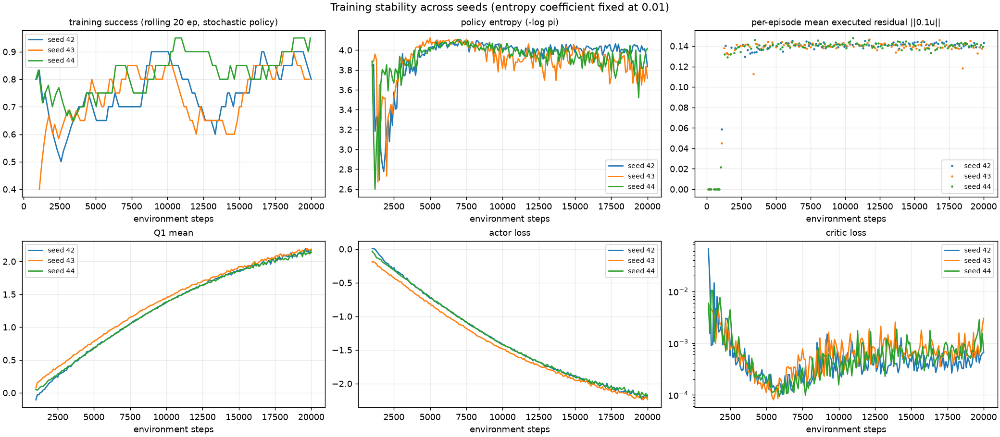
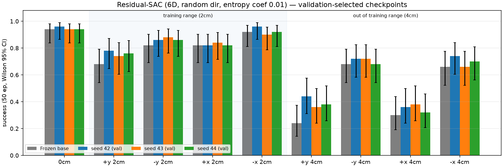
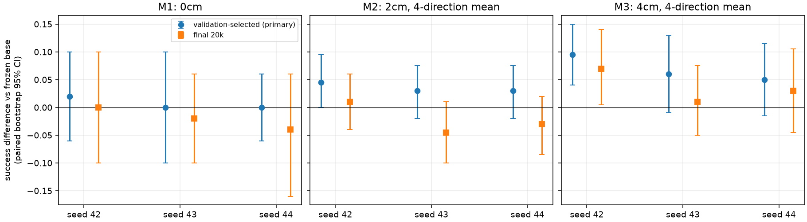
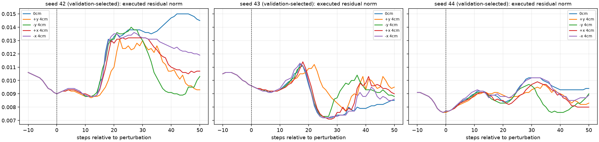
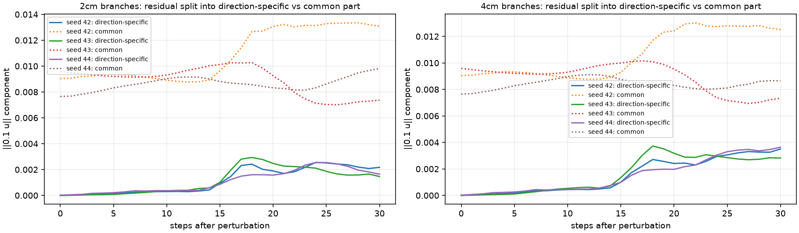
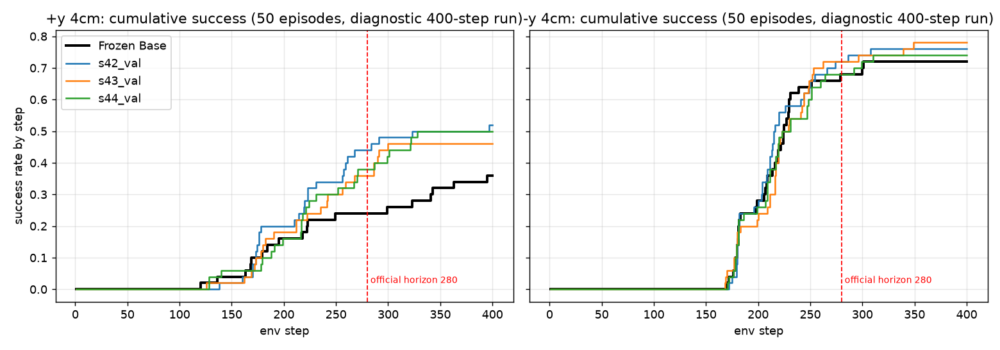

# Frozen SmolVLA + Residual-SAC: 강건성 및 교란 적응 검증

- 작성: 2026-11-24, 서버 `summit2`, 저장소 `~/rf/steer-frozen-vla`, 브랜치 `eval/residual-robustness`
- 연구 질문(RQ1): Residual RL은 동적 물체 교란에 대한 강건성과 반응적 적응을 개선하는가?
- 원본 결과: `results/residual_robustness/` (서버, git 미추적). 요약 사본: [`docs/evidence/residual_robustness/`](evidence/residual_robustness/)
- 표기: **측정**은 로그와 평가에서 직접 계산한 값이고, **추정**은 측정에 근거한 해석이다(인과 미확정).
- 이전 진단: [`residual-s42-diagnostics.md`](residual-s42-diagnostics.md) (auto-α 붕괴 원인과 고정 계수 0.01 선택 경위)

## 0. 결론 요약

**Residual-SAC가 동적 물체 교란에 적응할 수 있는가?** 이번 측정으로는 **"적응한다"고 말할 수 없다.**

1. **강건성 (측정)**
   - 세 seed 모두 validation 선정 checkpoint의 2cm, 4cm 평균 성공률이 Frozen Base보다 높았다.
     - M2(2cm): +3.0~+4.5%p
     - M3(4cm): +5.0~+9.5%p
   - 사전 등록한 9개 주 검정 중 Holm 보정 후 유의한 것은 seed 42의 M3(4cm, +9.5%p, Holm p = 0.017) 하나뿐이다.
     - seed 42의 test는 완전히 독립적인 검정이 아니다(§1.4).
     - 독립 seed인 43, 44에서는 유의한 개선이 없었다(Holm p ≥ 0.99).
   - 0cm 성공률은 유지됐다(94~96% vs 94%).
2. **반응적 적응 (측정)**
   - 교란 직전까지 같은 상태에서 출발해 방향만 다른 네 분기를 비교했다(C2). Residual의 방향별 차이는 방향 공통 성분의 4~11%에 불과했다.
   - Residual 출력만으로 교란 방향을 맞히는 정확도는 0.27~0.32로, 우연 수준(0.25)과 거의 같다.
   - 교란 직후부터 residual을 끈 ablation에서 성공률이 유의하게 떨어지지 않았다(모든 seed·거리에서 p ≥ 0.08).
3. **판정 (C4)**
   - seed 42는 **경우 1**(강건성은 있으나 반응적 보정 없음)이다.
   - seed 43/44는 경우 1의 경향을 보이지만 강건성 자체가 통계적으로 확인되지 않았다.
   - 경우 2, 3(방향 의존 보정)에 해당하는 seed는 없다.
4. **환경 검증 (§5)**
   - Task 0의 목표 물체는 50개 init state 모두에서 같은 위치에 놓인다.
   - 교란은 사실상 "EEF가 18cm 안으로 들어오는 순간" 한 시점에서만 발생한다.
   - ±y 4cm는 280 step 제한에 의해 결과가 잘린다. 400 step 진단 평가에서 Base와 Residual 모두 성공률이 올랐지만, Residual−Base 차이(±y 4cm 합산)는 280 step +7~+12%p에서 400 step +8~+10%p로 유지됐다. 280 step 결과는 공식 지표로 유지했다.
   - 위 강건성 결과는 이 세 조건 아래에서만 성립한다.

## 1. 설정 및 프로토콜

### 1.1 고정 후보 설정 (seed 42 이후 변경 없음)

| 항목 | 값 |
|---|---|
| Base | `lerobot/smolvla_libero` (frozen), LIBERO-Object task 0, `n_action_steps=10`, max 280 step |
| Residual | 6D 팔 보정(그리퍼 보정 없음), residual scale 0.1 (실행 보정 = 0.1·u) |
| SAC | 공통 `rl/` SAC(수정 없음), `autotune_alpha=False`, entropy coefficient 0.01 고정, 나머지 SACConfig 기본값 |
| 학습 교란 | 에피소드마다 ±x/±y 중 한 방향을 무작위로 골라 2cm 이동 |
| 학습량 | 20,000 env step, warmup 1,000 step(residual 0), batch 256, UTD 1, sparse success reward |
| Seed | 42(기존 결과 재사용), 43과 44(이번에 새로 학습) |
| 실행 | `scripts/launch_residual_variant.sh 6d_rand_fixa001 <gpu> <seed>` |

- **측정:** seed 43/44의 `base_config.json`은 seed 42와 비교해 seed와 run 경로만 다르다.
- `validation_rule.json`은 세 run 모두 같은 파일이다.

### 1.2 Checkpoint 선택 (사전 등록 규칙, `configs/validation_rule.json`)

- 후보: 2k~20k checkpoint, 1k 간격, 19개.
- 평가: ±x/±y 2cm × 각 10 에피소드, eval seed 1000.
- 선택: 성공 수가 가장 높은 checkpoint. 동점이면 나중 checkpoint.
- Validation과 test는 noise seed가 다르다(1000 vs 0).
- 다만 LIBERO init state는 에피소드 번호로 정해지므로, validation의 init state 0~9는 test의 init state 50개 중 10개와 겹친다(§8).

### 1.3 Test

- 9개 조건: 0cm, ±y 2cm, ±x 2cm, ±y 4cm, ±x 4cm. 조건마다 50 에피소드, eval seed 0.
- 에피소드 i는 모든 정책(Frozen Base 포함)에서 reset/noise seed i와 init state i를 같게 쓴다.
- 행동은 결정론적 `tanh(mu)`이다.
- 교란 대상은 `alphabet_soup_1`이다.
- 교란 규칙: step ≥ 10이고, EEF–물체 거리가 5~18cm이고, 로봇과 접촉하지 않을 때 한 번 평행이동한다.
  - 이 규칙은 정책의 궤적에 따라 발동하므로 **trigger step이 정책마다 다를 수 있다.** 실제 분포는 §3.5에 있다.

### 1.4 사전 등록 분석 (`configs/robustness_protocol.json`)

- seed 43/44의 validation과 test 결과가 나오기 전(15:10 KST)에 등록했다. 등록본은 `results/residual_robustness/robustness_protocol.registered.json`이다.
- **주 분석:** 각 seed의 validation 선정 checkpoint(`s<seed>_val`)를 Base와 비교한다.
  - M1: 0cm 성공률 차이
  - M2: 2cm 4방향 균등 평균 차이
  - M3: 4cm 4방향 균등 평균 차이
- **주 검정:** 3 seed × 3 지표 = 9개.
  - 에피소드별 차이 d_i에 대한 paired sign-flip permutation test(200,000회)
  - 9개에 Holm 보정
  - 95% paired bootstrap CI(10,000회)
- **보조 분석(기술 통계):** M4(거리별 방향 min/max/range), seed 간 변동, 20k 최종 checkpoint.
- **탐색 분석(보정 없음, 주장 근거로 쓰지 않음):** 조건별 exact McNemar(정책 세트당 27개), C1, C2, C3, 교란 후 residual ablation.
- **독립성 주의:** seed 42의 설정(고정 계수, 6D, 무작위 방향)은 이전 run들의 test seed(eval seed 0) 결과를 보고 골랐다.
  - 따라서 **seed 42의 test 결과는 완전히 독립적인 최종 test가 아니다.**
  - seed 43/44의 test 결과는 어떤 선택에도 쓰지 않았다.

## 2. 실험 A: Seed 반복과 학습 안정성



### 2.1 학습 지표 (측정, `T_training_summary.csv`)

| Seed | 학습 성공 에피소드 | Policy entropy 최솟값 (2k 이후) | 최종 entropy | Entropy 붕괴 | 최종 Q1 | 후반 critic loss | 최종 actor loss | 마지막 5k residual 노름 (실행) | 마지막 5k 포화율 | 선정 ckpt (val 점수/40) | 20k val 점수 |
|---|---|---|---|---|---|---|---|---|---|---|---|
| 42 | 83/109 | 3.08 | 3.83 | 없음 | 2.14 | 0.0005 | −2.17 | 0.142 | 1.6% | 12k (35) | 32 |
| 43 | 81/107 | 3.32 | 3.71 | 없음 | 2.19 | 0.0008 | −2.24 | 0.139 | 1.1% | 7k (35) | 31 |
| 44 | 95/114 | 3.52 | 4.02 | 없음 | 2.17 | 0.0007 | −2.20 | 0.140 | 1.6% | 6k (36) | 28 |

- Residual 노름과 포화율은 학습 중 샘플링된 행동 기준이다. Test에서 결정론적 행동의 실행 residual 노름은 0.012~0.018이다.

**Validation 점수 곡선 (측정, ±x/±y 2cm 40 에피소드 중 성공 수, 2k→20k)**
- seed 42: 31 31 34 33 33 32 32 31 32 33 **35** 31 31 32 31 31 32 31 32
- seed 43: 22 32 34 34 35 **35** 31 28 31 32 30 31 29 32 31 34 32 31 31
- seed 44: 32 31 30 33 **36** 33 33 34 29 30 29 25 32 33 28 27 35 26 28

### 2.2 측정

- **Entropy:** 세 seed 모두 entropy가 붕괴하지 않았다. 1k 구간 평균은 3.2~4.1 사이였다.
  - auto-α run들은 temperature가 약 0.003~0.005까지 내려가면서 붕괴했지만, 이번에는 그런 현상이 없었다.
  - entropy coefficient는 0.01로 고정되어 있다.
- **Loss:** critic loss는 1e-4~1e-3 수준이었다.
- **Q:** Q1은 세 seed 모두 0에서 약 2.1~2.2로 거의 직선으로 올라갔고, 20k에서도 포화하지 않았다.
- **Validation 점수:** 6k~12k에서 최고점이었고, 이후에는 2~4 낮은 수준에서 흔들렸다.
  - 20k 최종 checkpoint의 test M2는 세 seed 평균 −2.2%p(−4.5~+1.0)로, Base보다 오히려 낮은 쪽이었다(§3.3).
- **방향 편향:** 이전 auto-α run들에서 나타난 단일 방향 편향(+y 4cm 84% / −y 4cm 0% 같은 극단)은 세 seed 어디에도 없었다.
  - 선정 checkpoint 중 Base보다 낮은 방향은 seed 43의 −x 2cm(−2%p) 하나뿐이다(M4, §3.4).

### 2.3 추정

- 고정 계수가 entropy 붕괴와 그에 따른 단일 방향 편향은 막았다.
- 그러나 성능이 학습 후반까지 꾸준히 개선되지는 않았다.
- Q가 선형으로 계속 오르는 것은 entropy bonus(α·H ≈ 0.04/step)가 누적된 영향이 크기 때문일 수 있다. Reward가 희소해서 성공 신호가 Q에서 차지하는 비중이 작을 가능성이 있다.
- 따라서 "학습 안정성"은 확인됐지만 "학습이 수렴했다"는 근거는 없다.

## 3. 실험 B: 강건성 (280 step, 공식 지표)



### 3.1 조건별 성공률 (측정, 50 에피소드, Wilson 95% CI는 `R_success_by_condition.csv`)

| 정책 | 0cm | +y 2cm | −y 2cm | +x 2cm | −x 2cm | +y 4cm | −y 4cm | +x 4cm | −x 4cm |
|---|---|---|---|---|---|---|---|---|---|
| Frozen Base | 94 | 68 | 82 | 82 | 92 | 24 | 68 | 30 | 66 |
| s42_val (12k) | 96 | 78 | 86 | 82 | 96 | 44 | 72 | 36 | 74 |
| s43_val (7k) | 94 | 74 | 88 | 84 | 90 | 36 | 72 | 38 | 66 |
| s44_val (6k) | 94 | 76 | 86 | 82 | 92 | 38 | 68 | 32 | 70 |
| s42_final (20k) | 94 | 84 | 80 | 78 | 86 | 42 | 62 | 42 | 70 |
| s43_final (20k) | 92 | 64 | 78 | 76 | 88 | 36 | 56 | 34 | 66 |
| s44_final (20k) | 90 | 72 | 76 | 80 | 84 | 30 | 68 | 40 | 62 |

### 3.2 주 지표 (사전 등록 9개 검정, `R_primary_metrics.csv`)



| Seed | 지표 | Base | s_val | 차이 | 95% bootstrap CI | sign-flip p | **Holm p** |
|---|---|---|---|---|---|---|---|
| 42 | M1 0cm | 94.0 | 96.0 | +2.0 | [−6, +10] | 1.0 | 1.0 |
| 42 | M2 2cm | 81.0 | 85.5 | +4.5 | [0.0, +9.5] | 0.108 | 0.86 |
| 42 | M3 4cm | 47.0 | 56.5 | **+9.5** | [+4.0, +15.0] | 0.0019 | **0.017** |
| 43 | M1 0cm | 94.0 | 94.0 | 0.0 | [−10, +10] | 1.0 | 1.0 |
| 43 | M2 2cm | 81.0 | 84.0 | +3.0 | [−2.0, +7.5] | 0.31 | 1.0 |
| 43 | M3 4cm | 47.0 | 53.0 | +6.0 | [−1.0, +13.0] | 0.14 | 0.99 |
| 44 | M1 0cm | 94.0 | 94.0 | 0.0 | [−6, +6] | 1.0 | 1.0 |
| 44 | M2 2cm | 81.0 | 84.0 | +3.0 | [−2.0, +7.5] | 0.34 | 1.0 |
| 44 | M3 4cm | 47.0 | 52.0 | +5.0 | [−1.5, +11.5] | 0.20 | 1.0 |

- **다중 비교:** 주 검정은 위 9개뿐이고 Holm으로 보정했다.
- 그 밖의 비교는 탐색 분석으로 분류했고 주장의 근거로 쓰지 않는다. 여기에는 조건별 McNemar 54개(val, postoff), final checkpoint, ablation이 포함된다.
- seed 42의 유의한 결과(M3)는 독립성 주의(§1.4)가 붙는다.

### 3.3 Seed 간 변동 (보조, n = 3 seed, `R_seed_variability.csv`)

| Checkpoint | 지표 | 차이 평균 ± SD | 범위 | 양(+)의 seed 수 |
|---|---|---|---|---|
| val | M1 | +0.7 ± 1.2 | 0 ~ +2.0 | 1/3 (나머지 2개는 0) |
| val | M2 | +3.5 ± 0.9 | +3.0 ~ +4.5 | 3/3 |
| val | M3 | +6.8 ± 2.4 | +5.0 ~ +9.5 | 3/3 |
| final | M1 | −2.0 ± 2.0 | −4.0 ~ 0 | 0/3 |
| final | M2 | −2.2 ± 2.8 | −4.5 ~ +1.0 | 1/3 |
| final | M3 | +3.7 ± 3.1 | +1.0 ~ +7.0 | 3/3 |

- 에피소드를 seed처럼 독립 표본으로 취급하지 않았다. seed 수준 추론은 n = 3이라 기술 통계만 제시한다.
- **측정:** 효과의 방향(val M2, M3 > 0)은 세 seed에서 일관된다. 크기는 작고, seed 하나의 50 에피소드 검정력으로는 대부분 구분되지 않는다.

### 3.4 방향 일반화 M4 (보조, `R_direction_generalization_M4.csv`)

- val checkpoint의 방향 간 range는 2cm에서 0.16~0.18(Base 0.24), 4cm에서 0.36~0.38(Base 0.44)이다.
- 가장 약한 방향은 2cm에서 +y(74~78%, Base 68%), 4cm에서 +x 또는 +y(32~44%, Base 24~30%)이다.
- **측정:** Base보다 낮아진 방향은 seed 43의 −x 2cm(−2%p) 하나다. 개선은 Base가 약한 +y 4cm(+12~+20%p)와 +x 4cm(+2~+8%p)에 몰려 있다.

**탐색: 조건별 McNemar (보정 없음)**
- p < 0.05인 경우는 s42_val의 +y 4cm(12득/2실, p = 0.013)뿐이다.
- s44_val의 +y 4cm는 p = 0.065, s43_val의 +y 4cm는 p = 0.18이다.

### 3.5 교란 적용 검증 (측정, `R_perturbation_check.csv`, `checks/trigger_timing.csv`)

- 모든 정책·조건 run(본 평가 63개, ablation 24개, α=0 검사 3개)에서 교란이 50/50 에피소드에 적용됐다. 거부나 미발생은 0건이다.
- 실제 이동량은 설정값(0.02m, 0.04m)과 같았다.
- Trigger step 평균은 정책마다 33.1~33.7이다(Base 33.5, SD 2.7~2.8, 범위 27~39). EEF–물체 거리는 0.171~0.180m였다.
  - **Trigger step은 정책에 따라 다를 수 있지만, 실제 차이는 평균 0.6 step 이내로 작다.**
- 같은 정책 안에서 방향만 다른 네 run은 trigger 이전 관측이 완전히 같았고(최대 차이 0), trigger step도 50/50 에피소드에서 같았다. 이 성질을 C2에서 이용한다.

## 4. 실험 C: 교란 적응

### 4.1 C1: 교란 전후 residual (측정, `C1_*.csv`)



- 4cm에서 actor 출력 u(실행 = 0.1·u)를 교란 전후 구간별로 평균했다. 아래는 위치 성분(u_dx, u_dy)만 보인다.

| 정책 | 구간 | +y | −y | +x | −x |
|---|---|---|---|---|---|
| s42_val | 교란 전 (−10..−1) | (−.012, +.008) | 동일 | 동일 | 동일 |
| s42_val | +5..9 | (−.023, +.008) | (−.024, +.009) | (−.024, +.009) | (−.023, +.009) |
| s42_val | +10..19 | (−.017, +.003) | (−.025, −.004) | (−.022, −.001) | (−.020, −.002) |
| s43_val | +10..19 | (+.002, −.025) | (+.007, −.028) | (+.003, −.026) | (+.009, −.031) |
| s44_val | 교란 전 | (−.043, −.039) | 동일 | 동일 | 동일 |
| s44_val | +10..19 | (−.004, −.019) | (−.008, −.016) | (−.008, −.017) | (−.006, −.011) |

- **측정:** 교란 후 residual은 시간에 따라 변하지만, 그 변화는 네 방향에서 거의 같다(방향 간 차이 ≤ 0.008, 실행 기준 ≤ 0.0008).
- 교란 방향과 부호가 맞는 성분은 보이지 않는다. 예를 들어 +y와 −y 교란에서 u_dy가 서로 반대 부호로 바뀌지 않는다.
- Base 행동 대비 실행 행동의 차이(L1)는 교란 전후 모두 약 0.02로 거의 일정하다.

### 4.2 C2: 같은 교란 직전 상태에서 네 방향으로 분기 (측정, `C2_*.csv`)



| 정책 (4cm) | k=1 방향 특이 / 공통 | k=5 | k=10 | k=20 | 관측 발산 (k=20) |
|---|---|---|---|---|---|
| s42_val | 0.00003 / 0.0091 | 0.00017 / 0.0093 | 0.00044 / 0.0089 | 0.0024 / 0.0124 | 0.53 |
| s43_val | 0.00002 / 0.0095 | 0.00011 / 0.0092 | 0.00053 / 0.0093 | 0.0032 / 0.0095 | 0.57 |
| s44_val | 0.00007 / 0.0077 | 0.00026 / 0.0083 | 0.00046 / 0.0090 | 0.0020 / 0.0083 | 0.58 |

- k = 1..20 평균 비율(방향 특이 / 공통):
  - val checkpoint: 0.071~0.113
  - final checkpoint: 0.039~0.100
- LDA(에피소드 단위 교차검증, 교란 후 1~20 step)로 교란 방향을 맞힌 정확도:

  | 입력 | 정확도 | 우연 수준 |
  |---|---|---|
  | 관측 15차원 | 0.38~0.47 | 0.25 |
  | Residual 6차원 | 0.27~0.32 | 0.25 |

- **측정:** 같은 상태에서 방향만 바꿨을 때 residual이 달라지는 정도는 방향 공통 성분의 1/10 수준이다. 그 차이도 k = 10 이후, 즉 VLA가 재계획하고 관측이 갈라진 다음에야 커진다.
- **추정:** Residual의 관측은 proprio와 base action뿐이고 물체 위치가 없다. 그래서 residual은 교란을 VLA의 base action 변화를 통해서만 간접적으로 감지할 수 있다.
  - VLA는 10 step마다 재계획하므로 교란 직후 최대 10 step 동안은 관측 차이가 거의 0이다(k = 1에서 obs 발산 0.004).

### 4.3 C3: α = 0 wrapper sanity check (측정, `R_sanity_alpha0.csv`)

- seed 42의 final actor를 실행하되 실행 residual scale을 0으로 둔 run이다(0cm, +y 2cm, −x 4cm).
- 세 조건 모두 50/50 에피소드에서 성공 여부와 에피소드 길이가 Base와 같았다(47/34/33 성공).
- Residual wrapper 경로 자체는 결과를 바꾸지 않는다.

### 4.4 교란 후 residual ablation (탐색, `C_postperturb_ablation.csv`)

- 교란이 적용된 다음 step부터 residual을 0으로 끈 run(`s<seed>_val_postoff`)과 같은 checkpoint의 정상 run(full)을 비교했다.

| Seed | 거리 | full | postoff | Base | full − postoff | full만 성공 / postoff만 성공 | McNemar p |
|---|---|---|---|---|---|---|---|
| 42 | 2cm | 85.5 | 83.5 | 81.0 | +2.0 | 16 / 12 | 0.57 |
| 42 | 4cm | 56.5 | 55.0 | 47.0 | +1.5 | 24 / 21 | 0.77 |
| 43 | 2cm | 84.0 | 83.5 | 81.0 | +0.5 | 8 / 7 | 1.0 |
| 43 | 4cm | 53.0 | 54.0 | 47.0 | −1.0 | 15 / 17 | 0.86 |
| 44 | 2cm | 84.0 | 80.0 | 81.0 | +4.0 | 14 / 6 | 0.12 |
| 44 | 4cm | 52.0 | 46.5 | 47.0 | +5.5 | 22 / 11 | 0.08 |

- **측정 (seed 42, 43):** 교란 후 residual을 꺼도 성공률이 거의 그대로이고, Base 대비 이득(4cm +8%p, +7%p)도 남는다. 이득은 교란 이전 구간의 residual에서 나온다.
- **측정 (seed 44):** 교란 후 residual을 끄면 Base 수준으로 돌아간다. 다만 유의하지 않다(p = 0.08~0.12).
  - C2 비율이 0.09로 낮으므로, 이 기여는 방향을 구분하지 않는 공통 보정이다.
- 결론: 어느 seed에서도 "교란 방향에 맞춘 사후 보정이 성공을 만든다"는 근거는 없다.

### 4.5 C4: 판정

| Seed | 강건성 (주 검정) | 방향 의존 보정 (C1, C2) | 교란 후 residual 기여 (ablation) | 판정 |
|---|---|---|---|---|
| 42 | M3 +9.5%p, Holm p = 0.017 (독립성 주의) | 없음 (비율 0.07~0.09, LDA 0.30~0.31) | 없음 (+1.5~+2.0%p, p ≥ 0.57) | **경우 1**: 강건하나 반응적 보정 없음 |
| 43 | 유의하지 않음 (M2 +3.0, M3 +6.0) | 없음 (0.09~0.11, LDA 0.30~0.32) | 없음 (−1.0~+0.5%p) | 경우 1 경향, 강건성 미확인 |
| 44 | 유의하지 않음 (M2 +3.0, M3 +5.0) | 없음 (0.07~0.09, LDA 0.30~0.32) | 방향 무관 공통 기여 가능 (p = 0.08~0.12) | 경우 1 경향, 강건성 미확인 |

- **경우 2, 3에 해당하지 않는다.** 방향 의존 보정이 측정되지 않았다.
- **경우 4로 판정하지 않았다.** 근거는 다음과 같다.
  - Base보다 낮은 방향이 없다(seed 43 −x 2cm −2%p 제외).
  - 이전 auto-α run처럼 특정 방향에서만 성공하는 극단적 편향이 없다.
  - 다만 이득이 Base가 약한 +y 4cm, +x 4cm에 몰려 있다. 그래서 방향 무관 고정 보정이 우연히 이 방향들과 맞았을 가능성은 배제하지 못한다(추정).
- 경우 1과 4 범주에 따라 **"적응에 성공했다"는 표현은 쓰지 않는다.**

## 5. 환경 검증: 결과 해석의 전제

### 5.1 목표 물체 초기 위치 고정 (측정, `checks/init_pos_libero_object_all.json`)

- LIBERO-Object 10개 task × 50개 init state를 reset한 뒤(settle 10 step 포함) 물체 위치를 읽었다.
- **Task 0:**
  - `alphabet_soup_1`은 50개 모두 (−0.1191, −0.2398)에 있다. x, y 변동은 0mm다.
  - 그런데도 init state hash는 50개가 모두 다르다. 다른 물체 일부(±0.5cm)와 EEF 시작 위치(2.2~3.5cm 범위)가 달라지기 때문이다.
  - 이 좌표는 BDDL `target_object_region` (−0.145..−0.095, −0.265..−0.215), 즉 5cm × 5cm 영역의 정중앙이다.
- **다른 task:**
  - 목표 물체 위치가 고정인 task는 6/10이다(0, 2, 4, 5, 8, 9).
  - 나머지 4개(1 cream cheese, 3 bbq sauce, 6 butter, 7 milk)는 1~2cm 범위에서 변한다.
  - 고정 여부는 목표 여부가 아니라 물체 종류로 갈린다.
    - 고정: alphabet_soup, ketchup, salad_dressing, tomato_sauce, orange_juice, chocolate_pudding. 목표가 아닐 때도 고정이다.
    - 변동: cream_cheese, butter, milk, bbq_sauce.
- **의도 여부:** LIBERO가 배포한 init state 파일을 수정 없이 쓴 결과이고, 우리 코드가 만든 것이 아니다. LIBERO가 의도했는지는 코드와 데이터로 판단할 수 없다.
- **함의 (추정):**
  - 2cm 교란은 BDDL 영역 안쪽이지만, 4cm 교란은 영역(±2.5cm) 밖이다. 즉 4cm는 LIBERO 자체 배치 분포를 벗어난 조건이다.
  - 목표가 항상 같은 자리에 있으므로, residual은 방향 무관 고정 보정만으로도 성과를 낼 수 있다. C1과 C2에서 방향 반응이 없었던 것과 들어맞는다.
  - 이번 결과를 위치가 변하는 task로 일반화할 수는 없다.

### 5.2 교란 시점: 사실상 "18cm 진입 순간" (측정, `checks/trigger_timing.csv`)

- 모든 정책·조건에서 trigger 시 EEF–물체 거리는 100% 0.171~0.180m였다. 즉 거리가 18cm 안으로 처음 들어오는 step에서 교란이 일어났다.
- Step 범위는 27~39(중앙값 34)다.
- VLA는 10 step마다 재계획하는데, 교란이 재계획 주기 안 어디에서 일어나는지(step mod 10)는 0~9에 퍼져 있고 3~4에 몰려 있다.
- 교란(step 약 34) 이후 남은 시간이 길다. 0cm 성공 에피소드 길이 중앙값이 약 140 step이므로, 성공까지 약 100 step, 즉 VLA 재계획 약 10회가 남는다.
- **함의 (추정):**
  - 현재 프로토콜은 "접근 초반의 한 시점"만 시험한다.
  - 교란을 보상하는 주체는 주로 VLA의 시각 기반 재계획이다. Base가 2cm에 강한 이유도 이것으로 보인다.
  - 반응적 residual 보정이 필요한 상황, 예를 들어 잡기 직전이나 10 step 실행 도중의 교란은 시험하지 않았다.
- **논의:**
  - DSRL 비교의 주 프로토콜은 비교 가능성을 위해 현재 규칙을 유지한다.
  - 시점 다양화는 사전 등록한 보조 평가 축으로 추가할 것을 제안한다(§7.2).
    - 늦은 교란: EEF 6~10cm
    - 재계획 주기 내 위치를 통제한 교란
  - 학습 분포의 시점을 바꾸는 것은 학습 설정 변경이라 별도 결정이 필요하다.
  - 지금 관측에는 물체 위치가 없으므로, 늦은 교란에서도 residual의 방향 반응은 기대하기 어렵다(추정).

### 5.3 280 step 제한 (측정, `checks/horizon_censoring.csv`, `horizon400/`)

**공식 280 step 평가에서 측정한 검열 (`checks/horizon_censoring.csv`)**

- 모든 run에서 실패는 전부 280 step 시간 초과다. LIBERO는 성공했을 때만 에피소드를 끝내므로, 280 step 데이터만으로는 "막혀서 실패"와 "느려서 실패"를 구분할 수 없다.
- ±y 4cm의 성공 에피소드 길이 중앙값은 약 210 step으로, 0cm(약 140 step)보다 길다. 240 step 이후에도 성공이 계속 늘어난다.

  | 조건 | 정책 | 240 step까지 | 280 step까지 |
  |---|---|---|---|
  | −y 4cm | Base | 0.64 | 0.68 |
  | −y 4cm | s43_val | 0.54 | 0.72 |
  | +y 4cm | Base | 0.22 | 0.24 |
  | +y 4cm | s42_val | 0.34 | 0.44 |

- ±x 4cm와 2cm 조건은 200 step 전후에 성공률이 평탄해진다. 이 조건들은 280 step 제한의 영향이 작다.

**400 step 진단 평가 (공식 지표 아님, `horizon400/`)**

- 대상: Base와 s42/43/44_val, ±y 4cm, 각 50 에피소드.
- 280 step 공식 평가와 같은 checkpoint(sha256 일치), init state, noise seed를 썼다. 바꾼 것은 `--max-steps 400` 하나다.
- **Prefix 검증 (측정, `H_prefix_check.csv`):** 8개 run 모두 다음을 만족했다.
  - init state와 seed 50/50 일치, trigger step 50/50 일치
  - 280 step까지의 결과 50/50 일치: 280 이전에 성공한 에피소드는 같은 step에 성공했고, 실패한 에피소드는 280 이전에 성공하지 않았다.
  - 280 step까지 실행 행동과 residual의 최대 절대 차이가 0이었다(비교 step 수 11,434~12,866).
  - 즉 400 step run은 공식 run을 그대로 이어서 연장한 것과 같다.



**누적 성공률 (측정, %, `H_cumulative_success.csv`)**

| 조건 | 정책 | 240 | 280 (공식) | 320 | 360 | 400 |
|---|---|---|---|---|---|---|
| +y 4cm | Base | 22 | 24 | 26 | 32 | 36 |
| +y 4cm | s42_val | 34 | 44 | 48 | 50 | 52 |
| +y 4cm | s43_val | 26 | 36 | 46 | 46 | 46 |
| +y 4cm | s44_val | 30 | 38 | 44 | 50 | 50 |
| −y 4cm | Base | 64 | 68 | 72 | 72 | 72 |
| −y 4cm | s42_val | 58 | 72 | 76 | 76 | 76 |
| −y 4cm | s43_val | 54 | 72 | 74 | 78 | 78 |
| −y 4cm | s44_val | 54 | 68 | 74 | 74 | 74 |

**성공 시점 분포 (측정, `H_success_time_distribution.csv`)**

- 성공 시점 중앙값은 +y 4cm에서 220~222 step, −y 4cm에서 210~217 step이다. 정책 간 차이는 거의 없다.
- 281~400 step 사이 성공 수:
  - +y 4cm: Base 6, Residual 4~6
  - −y 4cm: Base 2, Residual 2~3
- 차이는 꼬리에서 나타난다.
  - +y 4cm에서 Base는 361~400 step에도 성공이 2건 있어 400 step까지 계속 오른다(36%).
  - Residual은 seed 43이 300 step, seed 44가 328 step 이후로 성공이 더 없다.

**Residual − Base 차이의 시간 변화 (측정, %p, `H_residual_minus_base.csv`, ±y 4cm 합산, paired)**

| Seed | 240 | 280 (공식) | 320 | 360 | 400 |
|---|---|---|---|---|---|
| 42 | +3 | +12 | +13 | +11 | +10 |
| 43 | −3 | +8 | +11 | +10 | +8 |
| 44 | −1 | +7 | +10 | +10 | +8 |
| 평균 (n=3) | −0.3 | +9.0 | +11.3 | +10.3 | +8.7 |

- 400 step의 bootstrap 95% CI: seed 42 [+2, +18], seed 43 [−1, +17], seed 44 [−1, +17].
- McNemar p(진단용, 보정 없음): 0.064, 0.17, 0.15.

**해석**

- **측정:** 280 step 제한은 Base와 Residual 모두의 ±y 4cm 성공률을 낮춘다. 400 step에서 Base는 +y 4cm +12%p, −y 4cm +4%p 올랐고, Residual은 +y 4cm +8~+12%p, −y 4cm +4~+6%p 올랐다.
- **측정:** Residual의 이득은 280 step 제한이 만든 착시가 아니다. 세 seed 모두 280~400 step 사이에서 +8~+13%p로 유지됐다. 다만 400 step에서는 정점(320 step)보다 2~3%p 줄어든다. Base의 +y 4cm 꼬리 성공이 늦게 따라오기 때문이다.
- **측정:** 240 step에서는 차이가 0 근처(−3~+3%p)였다. −y 4cm에서는 Residual이 240 step에 오히려 6~10%p 낮았다. 즉 Residual은 −y 4cm에서 Base보다 느리게 성공하고, 4cm 이득은 240~320 step 사이에 생긴다.
- **추정:** Residual은 ±y 4cm 교란 뒤 회복을 더 빠르게 하지 않는다. 대신 늦게라도 성공하는 에피소드 비율을 약간 늘린다. 이는 방향 반응이 없다는 C1, C2 결과와 충돌하지 않는다.
- **공식 지표는 280 step으로 유지한다.** 400 step 결과는 ±y 4cm 진단 실험이다. 주 검정(§3.2)에 섞지 않았고 다중 비교 보정도 적용하지 않았다.

## 6. 일곱 가지 질문에 대한 답

1. **고정 α가 seed 43/44 학습을 안정화하는가?**
   - entropy 붕괴는 없었다(최솟값 3.3, 3.5). Critic loss도 안정적이었다.
   - 그러나 validation 점수는 6k~7k에서 최고였고 이후 낮아졌다. 20k 최종 checkpoint는 2cm에서 Base 이하였다(M2 −4.5, −3.0%p).
   - **붕괴는 막았지만, 학습이 후반까지 계속 개선되지는 않는다.**
2. **2cm에서 더 강건한가?**
   - 세 seed 모두 +3.0~+4.5%p로 방향은 일관되지만, Holm 보정 후 유의한 seed는 없다.
   - **확인되지 않았다.**
3. **4cm로 일반화되는가?**
   - +5.0~+9.5%p로 방향은 일관된다. seed 42만 유의하다(독립성 주의). seed 43/44는 유의하지 않다.
   - ±y 4cm는 280 step 제한에 의해 잘린다. 400 step 진단에서도 Residual−Base 차이는 +8~+10%p로 유지됐다. 제한이 만든 착시는 아니지만, 독립 seed에서는 여전히 유의하지 않다(§5.3).
   - **약한 경향만 있고, 독립 seed로는 확인되지 않았다.**
4. **0cm 성능을 유지하는가?**
   - val checkpoint는 94~96%로 Base 94%와 같다. final checkpoint는 90~94%다.
   - **유지한다(val 기준).**
5. **교란 방향에 반응하는가?**
   - 방향 특이 성분은 공통 성분의 4~11%다. Residual로 방향을 맞히는 정확도는 우연 수준이다. 교란 후 residual을 꺼도 유의한 손실이 없다.
   - **반응하지 않는다.**
6. **세 seed가 일관적인가?**
   - 효과의 방향(val M2, M3 > 0, 방향 반응 없음)은 일관된다.
   - 크기와 유의성은 seed 42가 가장 크고, 교란 후 residual의 역할도 seed마다 다르다.
   - 최종 checkpoint는 일관되게 val checkpoint보다 나쁘다.
7. **DSRL 비교 프로토콜은?** §7에 정리했다.

## 7. DSRL 비교 기준과 평가 프로토콜 (제안)

### 7.1 기준 모델

- **Frozen SmolVLA** (zero residual): 모든 비교의 짝 기준이다.
- **Residual-SAC 고정 설정** (§1.1): seed 42/43/44의 validation 선정 checkpoint(12k, 7k, 6k)를 쓴다.
  - checkpoint 경로와 sha256은 각 평가 JSON에 기록되어 있다.
  - seed 42는 독립성 주의를 표시한다. 예산이 되면 두 방법 모두 새 seed(예: 45~47)로 반복할 것을 권한다.
- 최종 20k checkpoint는 보조로만 보고한다.

### 7.2 프로토콜

| 항목 | 규칙 |
|---|---|
| 학습 예산 | 20,000 env step, 같은 학습 교란 분포(에피소드마다 ±x/±y 무작위 2cm), sparse success reward, 같은 Frozen VLA 및 `n_action_steps=10` |
| Checkpoint 선택 | `configs/validation_rule.json`을 그대로 적용(2k~20k, ±x/±y 2cm × 10, eval seed 1000). DSRL test 결과를 보기 전에 선정한다. |
| Test | 9개 조건 × 50 에피소드, eval seed 0, 에피소드 i = init state i = noise seed i, 결정론적 행동 |
| 공식 horizon | 280 step. 400 step은 ±y 4cm 진단용으로 따로 보고한다(§5.3). |
| 주 지표 | M1/M2/M3: (a) 각 방법 vs Base, (b) **DSRL vs Residual-SAC** 에피소드별 paired 차이 |
| 주 검정 | sign-flip permutation(200k), 사전 등록한 검정 수 전체에 Holm 보정, paired bootstrap CI(10k). Seed 수준 결론은 3 seed의 방향 일관성과 범위로 서술한다. |
| 교란 검증 | 적용 50/50, 이동량, 정책별 trigger step 분포를 보고한다. |
| 적응 진단 | DSRL에도 같은 C2 분기 분석과 교란 후 개입 ablation을 적용한다(DSRL에서는 교란 후 latent noise를 기본 샘플링으로 되돌림). "적응"이라는 표현은 경우 2, 3일 때만 쓴다. |
| 보조 (사전 등록 필요) | (i) 교란 시점 다양화: EEF 6~10cm 늦은 교란 등, (ii) 목표 위치가 변하는 task(LIBERO-Object 1, 3, 6, 7)에서의 일반화 |
| 사전 등록 | DSRL 학습 전에 비교 수, 주 지표, 보정 방법을 JSON으로 고정한다(`configs/robustness_protocol.json` 형식). |

### 7.3 검정력 메모

- 50 에피소드 paired 설계에서 M2와 M3의 95% CI 반폭은 약 ±5~7%p다.
- 이번에 관측된 +3~+7%p 효과는 seed 하나로는 구분하기 어렵다.
- DSRL과의 차이가 5%p 이하라면 결론을 "차이 없음"이 아니라 "구분 불가"로 써야 한다.

## 8. 한계

- seed 42 test는 완전히 독립적인 test가 아니다(§1.4). 독립 증거는 seed 43/44뿐이다.
- Validation(eval seed 1000)과 test(eval seed 0)는 noise seed가 다르지만, init state 0~9가 겹친다. LIBERO-Object task 0의 init state는 50개다.
- Task 하나(목표 위치 고정), 교란 시점 하나(18cm 진입), 방향 4개, 거리 2개에 대한 결과다.
- Seed 3개로는 seed 수준의 통계 검정을 할 수 없다.
- 하이퍼파라미터 탐색은 하지 않았다. 고정 설정 하나에 대한 결과다.

## 9. 파일 및 재현

### 9.1 코드 (이 브랜치)

| 파일 | 역할 |
|---|---|
| `scripts/eval_residual.py` | 평가 스크립트. `smoke_rollout.py`와 같은 에피소드 구성을 쓴다. `--save-steps`, `--scale-override`(α=0 검사), `--residual-off-after-perturb`(ablation)를 지원한다. |
| `scripts/run_direction_eval.sh` | 9개 조건 병렬 평가. 환경 변수 `POLICIES`, `OUT`, `ONLY`, `MAX_STEPS`를 받는다. 기존 결과가 있으면 건너뛴다. |
| `scripts/run_robustness_chain.sh` | seed 하나에 대해 학습 대기 → validation과 선정 → 9개 조건 test(final, val) → 교란 후 ablation을 순서대로 실행한다. |
| `scripts/analyze_residual_robustness.py` | R_*, T_*, C* 분석(주 검정, Holm, bootstrap, C1, C2, ablation)과 그림을 만든다. |
| `scripts/check_init_positions.py` | LIBERO init state별 물체 위치를 확인한다(§5.1). |
| `scripts/check_trigger_timeout.py` | trigger 시점과 280 step 검열을 분석한다(§5.2, §5.3). |
| `scripts/analyze_horizon_400.py` | 400 step 진단의 prefix 검증, 누적 성공률, 차이의 시간 변화를 분석한다(§5.3). |
| `configs/robustness_protocol.json` | 사전 등록한 분석 프로토콜. |

- `rl/`과 DSRL 코드는 수정하지 않았다.
- 학습 코드(`train_residual.py`, `policies/`, `envs/`)는 이전 브랜치 상태 그대로다.

### 9.2 증거 (`docs/evidence/residual_robustness/`, 서버 원본의 복사본)

- `R_*.csv`, `T_*.csv`, `C*.csv`, `s4*_C_*.csv`, `figures/`: 강건성, 학습, 적응 분석 결과.
- `checks/`: 물체 위치(`init_pos_*.json`), trigger 시점(`trigger_timing.csv`), 280 step 검열(`horizon_censoring.csv`).
- `horizon400/`: 400 step 진단 결과(`H_*.csv`, `figures/H_cumulative_success.png`).
- `robustness_protocol.registered.json`: 15:10 KST에 등록한 사본.
- `runs/s43/`, `runs/s44/`: `base_config.json`, `config.json`, `summary.json`, `episodes.csv`, `train.csv`, `validation/selection.json`, `validation/validation_scores.csv`.
- 평가 원본(에피소드별 JSON과 step npz)은 서버 `results/residual_robustness/evals/`와 `evals_h400/`에 있다. 크기 때문에 git에는 넣지 않았다.

### 9.3 재현 명령 (서버, 저장소 루트)

```bash
# 학습 (seed 43/44; seed 42는 기존 run 재사용)
scripts/launch_residual_variant.sh 6d_rand_fixa001 0 43
scripts/launch_residual_variant.sh 6d_rand_fixa001 1 44
# validation -> 선정 -> 9개 조건 test (final, val) -> 교란 후 ablation
scripts/run_robustness_chain.sh 43 8
scripts/run_robustness_chain.sh 44 8
# 분석 (CPU)
source scripts/server_env.sh 0
CUDA_VISIBLE_DEVICES= "$PY" -B scripts/analyze_residual_robustness.py          # --perm 200000 --boot 10000 (기본값)
"$PY" -B scripts/check_init_positions.py libero_object 0,1,2,3,4,5,6,7,8,9 50 results/residual_robustness/checks/init_pos.json
CUDA_VISIBLE_DEVICES= "$PY" -B scripts/check_trigger_timeout.py
# 400 step 진단 (±y 4cm, 공식 지표 아님)
MAX_STEPS=400 ONLY="py4 my4" OUT=results/residual_robustness/evals_h400 \
POLICIES="base --zero-residual
s42_val --checkpoint results/residual_6d_rand_fixa001_2cm_s42_20k/checkpoints/ckpt_00012000.pt
s43_val --checkpoint results/residual_6d_rand_fixa001_2cm_s43_20k/checkpoints/ckpt_00007000.pt
s44_val --checkpoint results/residual_6d_rand_fixa001_2cm_s44_20k/checkpoints/ckpt_00006000.pt" \
  scripts/run_direction_eval.sh 8
CUDA_VISIBLE_DEVICES= "$PY" -B scripts/analyze_horizon_400.py
```
