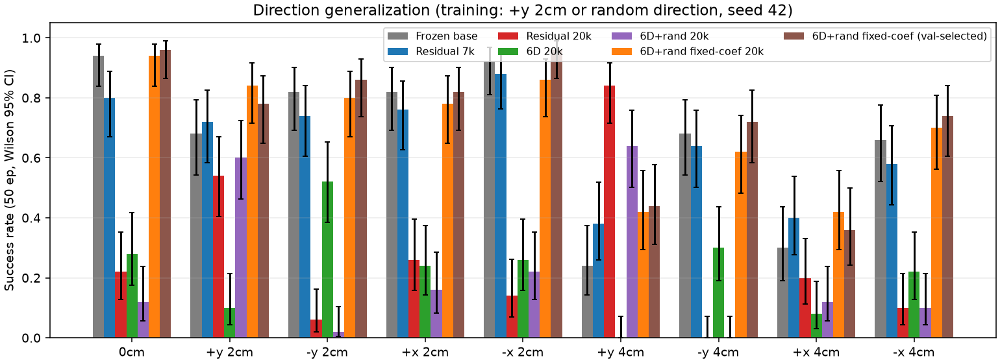
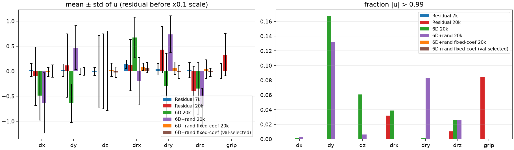
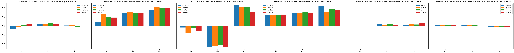
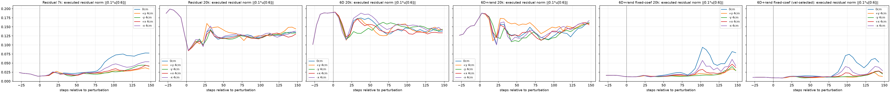
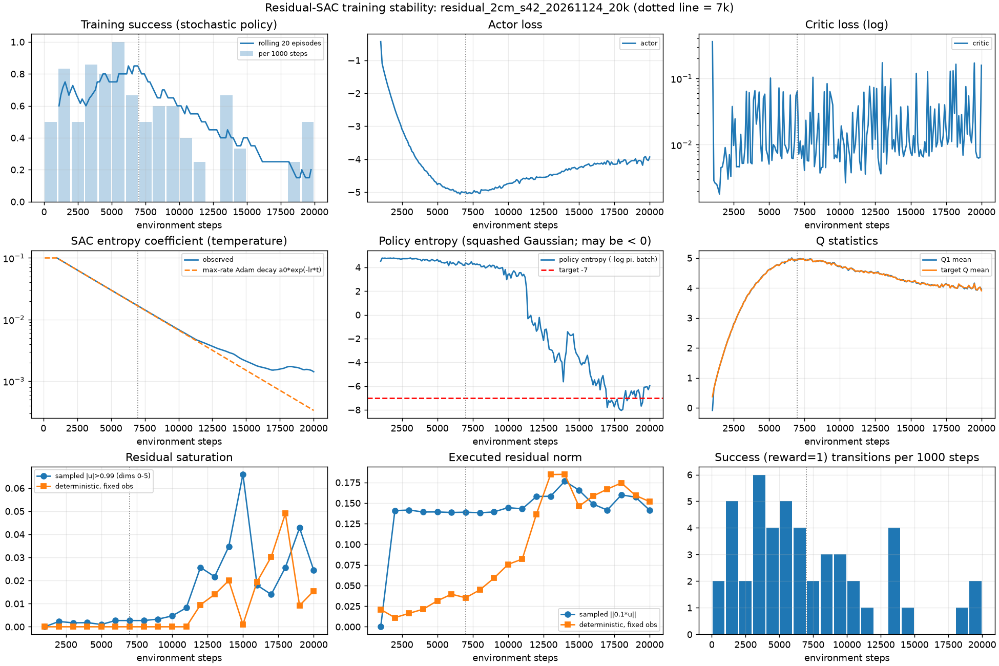
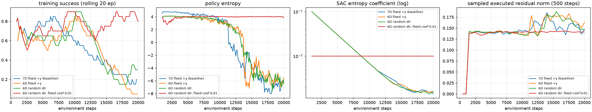
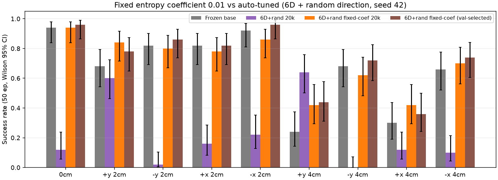

# Residual-SAC Seed 42 실패 원인 분석 및 방향 일반화 실험

- 작성: 2026-11-24, 서버 `summit2`, 저장소 `~/rf/steer-frozen-vla`
- 대상 학습: `results/residual_2cm_s42_20261124_20k/` (7D residual, +y 2cm 고정 교란, seed 42, 20,000 env step, 19,001 SAC update)
- 분석 결과 원본: `results/residual_s42_diagnostics/` (서버, git 미추적) / 요약 사본: [`docs/evidence/residual_s42_diagnostics/`](evidence/residual_s42_diagnostics/)
- 표기: **측정** = 로그·평가에서 직접 계산한 값, **추정** = 측정에 근거한 해석(인과 미확정)
- 용어: **Entropy Coefficient** = SAC 온도(`log_alpha`, 자동 조절). **Residual Scale** = `ResidualEnv.alpha = 0.1`(고정, 실행 보정 = 0.1·u). 두 값은 서로 다른 변수다.

## 0. 실험 설정 (재현용)

| 항목 | 값 |
|---|---|
| Task | LIBERO-Object task 0, `n_action_steps=10`, max 280 step |
| 평가 정책 | Frozen SmolVLA(잔차 0), Residual `ckpt_00007000.pt`, Residual `ckpt_00020000.pt`(= `latest.pt`, actor 가중치 동일 확인) |
| 평가 행동 | SAC actor 결정론적 출력 `tanh(mu)` |
| 교란 조건 | 0cm, ±y 2cm, ±x 2cm, ±y 4cm, ±x 4cm (9개) |
| 교란 규칙 | 대상 `alphabet_soup_1`, step ≥ 10, EEF–물체 거리 5–18cm, 로봇 비접촉, 물체 미들림일 때 1회 평행이동(모든 정책 동일 규칙) |
| Episode | 조건·정책별 50, eval seed 0 → 에피소드 i의 reset/noise seed = i (정책 간 동일 초기 상태 50개) |
| 통계 | Wilson 95% CI, Frozen Base와 에피소드 짝 exact McNemar(양측) |
| 실행 | `scripts/run_direction_eval.sh` → `scripts/eval_residual.py`, 분석 `scripts/analyze_residual_diagnostics.py` |

평가 파이프라인 검증(**측정**): 기존 9개 평가(Base 0/+y2/+y4, 7k·20k 0/+y2/+y4)를 새 스크립트로 재실행한 결과 50/50 에피소드 모두 성공 여부·초기 상태 hash·에피소드 길이가 동일(`A_reproducibility_check.csv`). 모든 27개 run에서 교란이 50/50 에피소드에 적용, 거부(충돌·작업영역)·미발생 0건, 실제 이동량 = 설정값.

## 1. 방향별 성공률 비교 (실험 A)



| 조건 | Frozen Base | Residual 7k | Residual 20k | 20k − Base | 20k McNemar p (득/실) |
|---|---|---|---|---|---|
| 0cm | 94% [84, 98] | 80% [67, 89] | 22% [13, 35] | −72%p | <1e-6 (0/36) |
| +y 2cm (학습 조건) | 68% [54, 79] | 72% [58, 83] | 54% [40, 67] | −14%p | 0.32 (15/22) |
| −y 2cm | 82% [69, 90] | 74% [60, 84] | 6% [2, 16] | −76%p | <1e-6 (0/38) |
| +x 2cm | 82% [69, 90] | 76% [63, 86] | 26% [16, 40] | −56%p | 1e-6 (3/31) |
| −x 2cm | 92% [81, 97] | 88% [76, 94] | 14% [7, 26] | −78%p | <1e-6 (1/40) |
| **+y 4cm** | 24% [14, 37] | 38% [26, 52] | **84% [71, 92]** | **+60%p** | <1e-6 (30/0) |
| −y 4cm | 68% [54, 79] | 64% [50, 76] | 0% [0, 7] | −68%p | <1e-6 (0/34) |
| +x 4cm | 30% [19, 44] | 40% [28, 54] | 20% [11, 33] | −10%p | 0.38 (8/13) |
| −x 4cm | 66% [52, 78] | 58% [44, 71] | 10% [4, 21] | −56%p | <1e-6 (1/29) |

7k vs Base(**측정**): 유의한 차이는 +y 4cm +14%p(p=0.039) 하나. 나머지 8개 조건은 −14~+10%p, p ≥ 0.065.

교란 발생 시점(**측정**): Base·7k 평균 33 step, 20k 평균 26 step — 20k 정책은 접근 궤적 자체가 달라 교란 규칙(거리 조건)을 더 일찍 만족한다. 같은 규칙이지만 정책 간 발생 step이 완전히 같지는 않다.

## 2. Residual 7k vs 20k 행동 분포 (실험 B)





**측정**
- 실행 보정 크기 ‖0.1·u[0:6]‖: 7k 0.027–0.039, 20k 0.134–0.138 (9개 조건 모두, 조건 간 차이 ≤ 0.004).
- 20k는 교란 **이전**부터 보정이 크다(교란 직전 ≈0.19). 교란 후 보정 크기 곡선이 0cm와 4개 방향에서 거의 겹친다 → 교란에 반응하는 보정이 아니다.
- 교란 후 평균 잔차(on-policy, 4cm): 20k는 방향과 무관하게 dy +0.28~+0.31, dz +0.34~+0.42, drz −0.42~−0.46. −y 교란에서도 +y 방향으로 민다. 7k는 모든 성분 |평균| ≤ 0.07(drx ≈ +0.15 제외).
- 포화 |u|>0.99 (동일 Base 관측 위): 7k 0%. 20k drx 3.2%, drz 1.1%, 효과 없는 gripper 차원 8.5%, 그 외 ≈0%. → 유효 차원에서 포화는 작다. 문제의 핵심은 포화보다 **큰 평균 편향**이다.
- 같은 관측에서 7k와 20k 출력의 cosine 평균 −0.06~+0.19 → 서로 거의 무관한 정책.
- "State와 무관한 일정 출력인가?": **아니다.** 동일 관측 위 차원별 std 0.5–0.7, 상수 벡터가 설명하는 잔차 에너지(constancy ratio) 0.16–0.36. 관측 일부를 평균으로 바꾸면 Base Action 7차원 교체 시 상대 변화 1.01, proprio 8차원 교체 시 0.34 → 20k 잔차는 주로 **Base Action 입력**에 반응한다.
- Base Action과 실행 Action 차이: 20k 평균 |exec−base| ≈ 보정 크기와 동일, 클리핑 비율은 낮음(`B_residual_summary.csv`).

**해석(추정)**: 20k 정책은 상태 의존적이지만, 그 의존성이 교란 방향을 반영하지 않는다. 궤적 평균으로는 +y/+z 쪽 이동과 z축 회전을 계속 더하는 편향이 남는데, 이 편향이 물체가 +y로 멀리(4cm) 이동한 경우에만 맞아떨어지는 것으로 보인다.

## 3. SAC 학습 안정성 (실험 C)



| 구간(env step) | 학습 성공 | Entropy Coef (끝) | Policy Entropy | 결정론적 ‖0.1u‖ | pre-tanh |μ| | 정책 std | 성공 transition |
|---|---|---|---|---|---|---|---|
| 0–7k | 28/37 ≈ 0.76 (창별 0.5–1.0) | 0.100 → 0.017 | 4.3–4.8 | 0.011–0.040 | 0.04–0.15 | 0.77–0.99 | 28 |
| 7–11k | 10/19 ≈ 0.53 | 0.012 → 0.005 | 3.4–4.3 | 0.045–0.082 | 0.17–0.33 | 0.75–0.82 | 10 |
| 11–13k | 1/7 | 0.004 → 0.003 | 0.5 → −1.7 | 0.137 → 0.185 | 0.79 → 1.21 | 0.82 → 0.70 | 1 |
| 13–20k | 8/28 ≈ 0.29 | 0.0028 → 0.0014 | −2.4 ~ −7.5 | 0.146–0.175 | 0.81–1.25 | 0.29–0.58 | 8 |

(창별 에피소드 수 3–7개 → 구간별 성공률의 불확실성이 크다.)

**측정**
1. **Entropy Coefficient 하락은 사전에 결정된 경로다.** 1k–11k 동안 관측값이 Adam 최대 속도 감소 `0.1·exp(−3e-4·update)`와 거의 일치(10k: 관측 0.00513 / 예측 0.00498). Policy entropy(+4.7)가 target(−7)보다 계속 높아 alpha 손실 기울기 부호가 한 방향으로 고정됐기 때문이다. 성능이 좋던 1–7k에도 같은 속도로 떨어지고 있었다.
2. **정책의 급변은 11–13k에 일어난다.** policy entropy 3.4 → −3.8, |μ| 0.33 → 1.21, 결정론적 보정 0.08 → 0.18이 동시에 나타나고, 같은 시기 학습 성공이 0/3까지 떨어진다.
3. **학습 성공 하락은 7k부터 시작돼 entropy 급변보다 앞선다.** 단 창당 에피소드가 적어 신뢰구간이 넓다.
4. **10k 이전 실행 잔차는 대부분 탐색 노이즈였다.** 샘플 보정 ≈0.14 vs 결정론적 0.01–0.07. 이 시기 학습 성공률은 학습된 보정보다 "Base + 노이즈" 성능에 가깝다.
5. **Q 크기는 entropy bonus가 지배한다.** Q 평균 4–5(7k에서 최고)는 task 보상으로 가능한 최대 할인 return 1을 크게 넘는다. 이후 Q 감소는 Entropy Coefficient 감소와 같은 방향이다.
6. 20,000 step 중 보상=1 transition 47개(0.24%). batch 256에 평균 0.6개.
7. Differential entropy가 음수인 것은 squashed Gaussian에서 정상이며 버그가 아니다.

### SAC 코드 점검 (`rl/sac.py`, `rl/trainer.py`; 수정하지 않음)

| 항목 | 판정 | 비고 |
|---|---|---|
| tanh-Gaussian log-prob, Jacobian(`2(log2 − u − softplus(−2u))`) | 정상 | 수치 안정형 |
| Action scaling(`_to_env`/`_to_norm`, [-1,1]) | 정상 | Residual Scale 0.1은 env에서 적용 |
| Twin-Q, target min, Polyak τ=0.005 | 정상 | |
| Truncation 처리(time-limit은 bootstrap, success만 done) | 정상 | |
| 자동 온도 조절 손실 `−log α·(logp + target)` | 수식 정상 | 단 아래 1·2 문제 |
| **1. target entropy = −7 vs 유효 차원 6** | 불일치 | `ResidualEnv`가 gripper 잔차를 0으로 지우므로 7번째 출력은 보상과 무관. entropy 목표에 죽은 차원이 포함되고, 실제로 20k gripper 출력이 가장 많이 포화(8.5%)됐다. |
| **2. 초기 온도·학습률과 목표의 거리** | 설계 문제 | entropy가 목표보다 ~12 nats 높아 온도가 매 update 최대 속도로 감소 → 성능과 무관한 고정 스케줄. |
| **3. 보상 대비 entropy bonus 규모** | 설계 문제 | sparse 보상(≤1) 대비 soft-Q의 entropy 항이 큼. |
| 4. warmup policy = zero | 참고 | 첫 1,000 transition의 action이 모두 0 → 초기 critic이 action 변화를 보지 못함. |

논리적 버그는 발견하지 못했다. 위 1–3은 이 과제 설정과의 불일치이며, 수정은 `rl/` 밖에서(설정·env 쪽) 가능하다(§6).

## 4. 가설 검증

| 가설 | 판정 | 근거(측정) | 한계 |
|---|---|---|---|
| **H1** +y 고정 교란 특화 편향 | **"방향 무관 편향"은 지지, "+y 특화"는 기각 쪽** | 20k가 Base보다 나은 조건은 +y 4cm 하나(+60%p), 나머지 8개 중 7개에서 −56~−78%p. 교란 후 평균 잔차가 4개 방향에서 같은 부호·크기, 보정 크기 곡선이 0cm와 4방향에서 동일. **그러나** 같은 +y 고정 교란으로 학습한 6D run은 반대 방향 편향(dy ≈ −0.45)을 학습했고 +y 4cm에서 0%였다(§6.1). | 편향의 방향은 학습 방향이 아니라 run마다 다르게 정해지는 것으로 보인다(seed 1개씩). 7D run의 +y 4cm 84%는 편향 방향이 우연히 맞은 결과로 해석하는 편이 데이터와 더 맞는다. |
| **H2** Entropy Coef 감소·포화가 불안정에 기여 | **Coef 부분은 지지 강화, 포화 부분은 약함** | Coef는 세 run 모두 같은 고정 스케줄로 감소. 정책 붕괴(policy entropy 급락, |μ| 0.3→1.0+, 보정 0.06→0.15+)가 세 run 모두 Coef ≈0.003–0.005 구간(7D 11–13k, 6D 두 run 13–14k)에서 발생. 설정(7D/6D, 고정/무작위 방향)이 달라도 시점이 Coef 경로를 따라간다. 유효 차원 포화는 ≤7%로 작음. | 여전히 상관관계. 세 run이 같은 seed·같은 Coef 경로를 공유하므로 Coef 하한/고정 ablation으로만 인과 확인 가능. |
| **H3** 현재 State로 방향 구분 어려움 | **부분 지지** | Base rollout 관측으로 4방향 LDA(에피소드 단위 5-fold): 교란 전 25%(=chance, 관측이 동일), 교란 후 0–20 step 44.5%(4cm)/37.3%(2cm), 교란 후 전체 54.7%/40.8%. Base Action 7차원만으로는 31.6%/28.6% — VLA 출력에 방향 정보가 약하고, 정보는 주로 이후 로봇 상태 변화(proprio)에 있음. | 선형 판별 기준 하한. 고정 +y 학습에서는 방향을 구분할 필요 자체가 없었으므로 H3만으로 H1을 설명할 수 없다. |

## 5. 가장 가능성 높은 원인 (추정)

1. **Entropy Coefficient가 고정 스케줄로 ≈0.003–0.005 아래로 내려가면, 정책이 과제와 무관한 큰 편향 잔차로 수렴한다.** 세 run 모두 같은 Coef 구간에서 붕괴했고, 편향 방향은 run마다 다르며(+y / −y / +y), 어느 run도 학습 조건을 개선하지 못했다(7D +y 2cm 54%, 6D 10%, 6D+rand 60% vs Base 68%).
2. **보상 신호가 이 편향을 막기에는 너무 약하다.** 성공 transition 47개(0.24%), Q 크기는 entropy bonus가 지배한다. Coef가 큰 동안에는 탐색 노이즈가 행동을 지배했고(실행 잔차 ≈ 노이즈), Coef가 작아지자 근거가 약한 critic 기울기를 따라 actor가 이동한 것으로 보인다.
3. **관측의 방향 정보가 약하고 늦게 나타난다**(H3). 무작위 방향으로 학습해도 정책은 방향별로 다른 보정을 학습하지 않았다(§6.1).

근거 수준: 1은 세 run의 시점 일치(측정)에 기반한 추정, 2는 Q 규모·보상 통계(측정) 기반 추정, 3은 LDA와 6D+rand 평가(측정) 기반.

## 6. 후속 실험 및 다음 학습 수정

### 6.1 후속 실험 (2026-11-24 실행, seed 42, +y/무작위 2cm, 20k step, 나머지 하이퍼파라미터 동일)

| Run | 변경 | 경로 |
|---|---|---|
| 6D | 잔차 6차원(gripper 제외), SAC target entropy −6 | `results/residual_6d_2cm_s42_20k/` |
| 6D+rand | 6D + 에피소드마다 교란 방향 무작위(±x/±y, 각 21–25 에피소드로 확인) | `results/residual_6d_rand_2cm_s42_20k/` |



최종 체크포인트(20k, 사전에 정한 평가 대상) 성공률 — 50 에피소드, Frozen Base와 같은 초기 상태·noise seed:

| 조건 | Base | 7D 20k | 6D 20k | 6D+rand 20k |
|---|---|---|---|---|
| 0cm | 94% | 22% | 28% | 12% |
| +y 2cm | 68% | 54% | 10% | 60% |
| −y 2cm | 82% | 6% | 52% | 2% |
| +x 2cm | 82% | 26% | 24% | 16% |
| −x 2cm | 92% | 14% | 26% | 22% |
| +y 4cm | 24% | **84%** | 0% | **64%** |
| −y 4cm | 68% | 0% | 30% | 0% |
| +x 4cm | 30% | 20% | 8% | 12% |
| −x 4cm | 66% | 10% | 22% | 10% |

(CI·McNemar: `A_direction_success.csv`, `A_direction_vs_base_mcnemar.csv`. 6D는 9개 조건 모두 Base보다 낮음, p ≤ 0.001. 6D+rand는 +y 4cm만 Base보다 높음, +40%p, p=1e-5.)

**측정**
- 세 run 모두 같은 Entropy Coef 경로(고정 스케줄), 같은 붕괴 패턴: policy entropy +4 → −4~−7, 결정론적 보정 0.06 → 0.15+, |μ| 0.2 → 1.0+. 6D 두 run은 13–14k에서 붕괴(7D보다 1–2k 늦음).
- 교란 후 평균 잔차는 세 run 모두 **방향과 무관**하다: 6D dy −0.43~−0.47 / dz +0.31~+0.46, 6D+rand dy +0.28~+0.31 / dz +0.31~+0.44.
- 6D run은 +y 고정 학습인데 −y 편향을 학습했다. 성공 조건 패턴도 이와 일치한다(−y 2cm 52%로 가장 높고, +y 4cm 0%).
- 무작위 방향 학습은 방향 조건부 보정을 만들지 못했다.

**해석(추정)**
- 6D(죽은 차원 제거)는 그 자체로 바람직한 수정이지만, 붕괴를 막지는 못했다.
- 방향 무작위화도 Coef 붕괴가 남아 있는 한 효과를 확인할 수 없다.
- 붕괴의 공통 요인은 Entropy Coef 경로로 좁혀진다.

### 6.2 다음 학습에서 수정할 설정 (한 번에 하나)

1. **최우선: Entropy Coefficient 고정(또는 하한).** 6D+rand 설정은 유지하고 `SACConfig(autotune_alpha=False, init_alpha=0.01)`만 바꾼다.
   - 0.01은 세 run이 아직 안정적이던 7–9k 구간의 값이다(0.017–0.009).
   - `rl/` 수정 없이 설정만으로 가능하다. 하한 방식은 `rl/` 밖 wrapper가 필요하다.
   - 검증 기준: 붕괴 시점(policy entropy 급락) 유무, 그리고 4방향 평가에서 Base 대비 비열화.
2. **함께 넣을 수 있는 것(학습 동역학 불변): Validation checkpoint 선정.**
   - 1k마다 held-out seed로 ±x/±y 2cm 각 10 에피소드를 결정론적으로 평가한다.
   - 최고 checkpoint를 사전 규칙으로 선택하고, 최종 보고는 별도 seed로 50 에피소드를 평가한다.
   - 학습 자체를 바꾸지 않으므로 1번과 같이 넣어도 원인 분리를 해치지 않는다.

**보류:** Reward shaping은 1번 이후에도 불안정할 때 다음 단계로 둔다. 보상은 목적함수 자체를 바꾸므로 Coef 효과와 섞이지 않도록 한다. Residual Scale 축소와 크기 페널티도 1번 결과를 보고 판단한다.

**한계:** 모든 run이 seed 1개다. 1번 실험은 seed 42/43/44 세 개로 돌리는 것을 권장한다.

## 7. 파일·재현

**코드** (공통 `rl/` 무수정, 새 옵션은 모두 opt-in이며 기본값은 기존 동작과 같다)

| 파일 | 내용 |
|---|---|
| `scripts/eval_residual.py` | Residual 정책 평가(Base와 같은 seed 경로). `--zero-residual`, `--axis/--direction`, `--save-steps`, 6D checkpoint 지원 |
| `scripts/compare_residual_eval.py` | Base와 에피소드 짝 비교: Wilson CI, exact McNemar, 교란 적용/거부/미발생 |
| `scripts/run_direction_eval.sh` | 정책 × 9조건 × 50 에피소드 일괄 실행. 기존 결과는 skip, `POLICIES` 환경변수로 정책 지정 |
| `scripts/analyze_residual_diagnostics.py` | 실험 A/B/C 표·그림 생성 |
| `scripts/launch_residual_variant.sh` | 후속 run 실행(`6d`, `6d_rand`). 기존 run 덮어쓰기 거부 |
| `policies/residual_policy.py` | `residual_dims=6` 옵션 |
| `envs/perturbation.py` | `PerturbationConfig.directions`: 에피소드 seed로 방향 결정(Resume 안전). info에 `perturb_axis/sign` 기록 |
| `train_residual.py` | `--residual-dims`, `--random-direction`. Resume 시 두 설정 변경 거부 |
| `tests/test_perturbation.py`, `tests/test_residual_env.py` | 신규 테스트 5개 (전체 28개 통과) |

**결과**
- 서버 원본(git 미추적): `results/residual_s42_diagnostics/`
  - `evals/*.json`: 45개 run, 에피소드 기록
  - `evals/*.steps.npz`: step별 obs, 잔차, base/exec action
- 저장소 사본: `docs/evidence/residual_s42_diagnostics/`
  - CSV 21개, 그림 12개
  - `experiment_config.json`: 평가별 checkpoint sha256, seed 규칙, 교란 조건
  - `followup_runs/`: 6D·6D+rand run의 설정, 학습 로그, 요약

**재현 명령**
```bash
scripts/run_direction_eval.sh 12                                   # seed 42 7D: base/7k/20k
POLICIES="v6d_final --checkpoint results/residual_6d_2cm_s42_20k/checkpoints/ckpt_00020000.pt" \
  scripts/run_direction_eval.sh 12                                 # 후속 run 예시
python scripts/analyze_residual_diagnostics.py --parts A B C
```

## 8. 후속 실험: Entropy Coefficient 0.01 고정 (seed 42, 2026-11-24 실행)

- Run: `results/residual_6d_rand_fixa001_2cm_s42_20k/` (`scripts/launch_residual_variant.sh 6d_rand_fixa001 0 42`)
- 변경점은 6D+rand 설정에 `SACConfig(autotune_alpha=False, init_alpha=0.01)`을 적용한 것 하나뿐이다. 공통 `rl/`은 수정하지 않았다.
- 학습 중 Entropy, Actor/Critic Loss는 `train.csv`에, 에피소드별 실행 Residual Norm과 포화 비율은 `episodes.csv`에 기록했다.
- 20,000 step, 19,001 update로 정상 종료했다. VLA는 frozen 상태이고 오류는 없다.

### 8.1 사전 등록 Validation
- 규칙은 학습 시작 전에 run 디렉터리에 저장했다(`validation_rule.json`).
- 후보는 ckpt 2k~20k(19개)이다. 검증 조건은 ±x/±y 2cm 각 10 에피소드, eval seed 1000, 결정론적 actor이고, 점수는 40 에피소드 중 성공 수다.
- 결과: 모든 checkpoint가 31~35/40에 분포했다. 선정은 **12k(35/40)**, 최종 20k는 32/40이다(`validation/validation_scores.csv`).
- 점수 차이가 40 에피소드 기준 noise 수준이므로, 이번 validation이 checkpoint를 거의 구분하지 못했다는 점도 함께 기록한다.

### 8.2 9개 조건 평가 (50 에피소드, Frozen Base와 같은 초기 상태·noise seed)



| 조건 | Frozen Base | 6D+rand (Coef 자동) | **Coef 고정 20k** | Coef 고정 12k (val 선정) |
|---|---|---|---|---|
| 0cm | 94% [84, 98] | 12% | **94%** [84, 98] (p=1.0) | 96% [87, 99] (p=1.0) |
| +y 2cm | 68% [54, 79] | 60% | **84%** [71, 92] (p=0.021) | 78% [65, 87] (p=0.18) |
| −y 2cm | 82% [69, 90] | 2% | **80%** [67, 89] (p=1.0) | 86% [74, 93] (p=0.69) |
| +x 2cm | 82% [69, 90] | 16% | **78%** [65, 87] (p=0.75) | 82% [69, 90] (p=1.0) |
| −x 2cm | 92% [81, 97] | 22% | **86%** [74, 93] (p=0.45) | 96% [87, 99] (p=0.63) |
| +y 4cm | 24% [14, 37] | 64% | **42%** [29, 56] (p=0.022) | 44% [31, 58] (p=0.013) |
| −y 4cm | 68% [54, 79] | 0% | **62%** [48, 74] (p=0.58) | 72% [58, 83] (p=0.75) |
| +x 4cm | 30% [19, 44] | 12% | **42%** [29, 56] (p=0.11) | 36% [24, 50] (p=0.51) |
| −x 4cm | 66% [52, 78] | 10% | **70%** [56, 81] (p=0.73) | 74% [60, 84] (p=0.22) |

(p = Frozen Base 대비 exact McNemar. 모든 run에서 교란이 50/50 적용됐고 거부는 0건이다.)

### 8.3 측정
- **후반부 붕괴 없음.** Policy entropy가 3.9~4.1로 유지됐다(자동 조절 run은 −4~−7까지 떨어졌다).
- 결정론적 실행 잔차 ‖0.1u‖는 5k 이후 0.014~0.022이다. 2k에서 일시적으로 0.063까지 올랐다가 4k까지 0.026으로 내려왔다(자동 조절 run 후반은 0.15~0.19). 5k 이후 pre-tanh |μ|는 0.05~0.08, 정책 std는 0.84~0.87이고, 전 구간 포화는 0%다.
- 학습 성공률(창별)은 0.4~1.0으로 하락 추세가 없다. 마지막 5k 구간은 0.6~1.0이다.
- 교란 후 평균 잔차는 4cm 4방향 모두 |성분| ≤ 0.1이다. 큰 편향은 사라졌다.
- **20k 정책은 9개 조건 어디서도 Base보다 유의하게 나쁘지 않다**(최대 −6%p, p ≥ 0.45). 자동 조절 6D+rand는 7개 조건에서 −56~−82%p였다.
- Base보다 높은 조건은 +y 2cm(+16%p, p=0.021)와 +y 4cm(+18%p, p=0.022)다. 다만 18개 비교에 Bonferroni 보정(0.05/18 ≈ 0.0028)을 적용하면 어느 것도 유의하지 않다.
- Q 평균은 0 → 2.1로 꾸준히 증가하며 수렴하지 않았다. α·H ≈ 0.04/step이 계속 들어오므로 Q 크기는 여전히 entropy bonus가 지배한다.

### 8.4 해석 (추정)
- 세 run 공통의 붕괴는 Entropy Coefficient 자동 감소와 강하게 연관되어 있었다. 이번에 그 하나만 고정하자 붕괴가 사라졌다. 이 결과는 H2의 Coefficient 부분을 seed 1개 수준에서 **인과적으로 지지**한다(단일 변경 ablation).
- 대신 정책은 Base에 가까운 작은 보정(‖δ‖≈0.02)에 머물렀다. 강건성 향상은 작고 통계적으로 약하다.
- Coef 0.01에서도 학습 중 행동은 여전히 탐색 노이즈가 지배하고(샘플 ‖δ‖≈0.14), 보상 신호(성공 transition 0.24% 수준)가 약하다. 개선 폭이 작은 것은 이 두 요인 때문일 가능성이 있다.
- 결론적으로 이 설정은 **"붕괴 없이 Base 수준을 유지하는 Residual-SAC"**이다. DSRL 비교의 Residual-SAC 기준점으로 쓸 수 있지만 seed 1개뿐이다.

### 8.5 다음 단계
- 사용자 결정에 따라 Residual-SAC 하이퍼파라미터 탐색은 여기서 중단한다.
- DSRL 비교용 최종 설정 후보는 **6D + 무작위 방향 + Entropy Coefficient 0.01 고정 + 사전 등록 validation**이다.
- 비교에 쓰려면 seed 43/44 추가 학습이 필요하다(아직 시작하지 않음).
