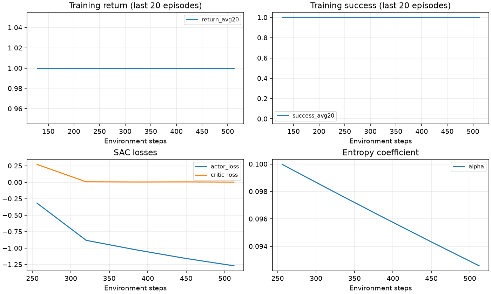

# Residual-SAC 학습 시작 — 2026-11-24

## 기준 코드·변경 보존

`f0687f4`를 기준으로 최신 `origin/main`을 확인했고, 착수 시 추가 팀 커밋이나 서버 작업 복사본의 변경은 없었다.
공통 `rl/`은 수정하지 않았다. `git diff f0687f4 -- rl`이 비어 있음을 서버와 로컬에서 확인했다.
학습 기록·검증 도구 변경은 `3fb3686`에 저장했다. 기존 실험은 덮어쓰지 않고 별도 run 디렉터리를 사용한다.

공통 CSV logger는 첫 row에서 열을 고정하므로 warm-up 중에는 loss 열이 빠질 수 있다.
`scripts/training_monitor.py`에서 처음부터 loss 열을 예약해 해결했으며 SAC 소스는 변경하지 않았다.

## 보상·transition·행동 주기 검증

LIBERO-Object ID 0, 대상 `alphabet_soup_1`, 접근 중 y+ 2cm 이동 조건으로 실제 episode를 실행했다.

- 보상: 매 step `float(task_success)`와 실제 reward가 일치하는 sparse 0/1 보상. Shaping·residual penalty 없음.
- Transition: 환경 control step 1개당 replay tuple 1개. Actor action(7차원 residual)을 저장하며 최종 실행 action을 replay action으로 바꾸지 않는다.
- 종료: `terminated`만 replay done으로 저장하고 time-limit `truncated`는 bootstrap한다.
- VLA: `n_action_steps=10`, 실제 query step `0,10,20,...,120` 확인.
- Residual: 매 control step 적용. 첫 21 step 동안 부호가 번갈아 바뀌는 보정을 주고 실제 실행 action이 `clip(base + 0.1*u)`와 일치함을 확인.
- Gripper: 기존 규약대로 7번째 residual은 0으로 둔다. SAC 출력은 이미 tanh를 거쳤으므로 다시 적용하지 않는다.
- 실제 결과: 123 control step / replay 123개 후 성공. 29 step에서 접촉 전 0.02m 교란 적용.

원시 검증: [residual_contract_audit.json](evidence/residual_pilot/residual_contract_audit.json).

## 짧은 학습 결과

Seed 41, 같은 task·2cm 교란·`n_action_steps=10`, alpha=0.1.
512 환경 step, zero-residual warm-up 256 step, batch 256, UTD=1.

- 실제 SAC update **257회**.
- 최종 critic loss `0.001938`, actor loss `-1.269697`, entropy coefficient `0.092575`.
- Actor·Critic 변경, VLA frozen 유지 확인.
- Replay 512개, reward가 양수인 transition 2개. 완료된 학습 episode 2개는 모두 성공했으나,
  warm-up을 포함한 아주 짧은 수집 결과이며 학습 성능 향상이나 별도 평가 성공률로 해석하지 않는다.
- 256/512 step checkpoint와 replay 저장, 유한한 loss·관측·action 범위·curve 파일 검증 통과.
- 관련 테스트 10개 통과(기존 residual·교란 검증 및 warm-up 전후 loss 열 보존 회귀 검증).

[검증 결과](evidence/residual_pilot/residual_2cm_pilot_validation.json),
[최종 지표](evidence/residual_pilot/summary.json),
[학습 로그](evidence/residual_pilot/train.csv),
[Episode 로그](evidence/residual_pilot/episodes.csv),
[실행 설정·소스 해시](evidence/residual_pilot/base_config.json).

## Seed 42 본 학습

짧은 학습 검증 통과 후 GPU 0에서 새로 시작했다. Pilot checkpoint나 replay를 가져오지 않는다.

| 설정 | 값 |
| --- | --- |
| Task | LIBERO-Object ID 0 |
| 교란 | alphabet_soup_1, y+ 2cm, 기존 pre-contact gate |
| seed | 42 |
| 예산 | 20,000 환경 control step |
| n_action_steps | 10 |
| Residual 결정·적용 | 매 control step |
| alpha / gripper | 0.1 / gripper residual 비활성 |
| Warm-up | zero residual 1,000 step |
| SAC | batch 256, UTD 1, 기존 기본 learning rates·gamma·tau |
| 기록 | 100 환경 step마다 loss·training return·최근 20 episode training success |
| 저장 | 1,000 환경 step마다 agent·optimizer·RNG checkpoint 및 replay |
| 곡선 | x축 환경 step, 학습 return·training success·Actor/Critic loss·entropy coefficient |

서버 경로: `~/rf/steer-frozen-vla/results/residual_2cm_s42_20261124_20k/`.

- `console.log`, `process.pid`: 실행 로그·PID
- `config.json`, `base_config.json`: 설정·checkpoint revision·실제 사용 코드 해시
- `train.csv`, `episodes.csv`: 학습 지표·episode 결과
- `learning_curves.png`: 자동 갱신되는 환경 step 기준 곡선
- `checkpoints/latest.pt`, `checkpoints/ckpt_XXXXXXXX.pt`, `checkpoints/replay_buffer.npz`: 복구 상태
- `summary.json`: 전체 예산을 마친 뒤 생성

이 실행은 **진행 중인 단일 학습 seed**다. `success_avg20`은 탐색과 warm-up을 포함한 training 지표이며
독립 평가 성공률이 아니다. 학습 완료 후 별도 평가 50 episode 이상·95% CI와 복수 학습 seed 검증이 필요하다.

### 실제 시작 확인 스냅샷

2026-11-24 11:21:41 KST 확인 시 프로세스 PID `2320893`이 실행 중이었다.
최신 기록은 1,900 환경 step / SAC update 901회 / VLA 호출 196회였다.
당시 latest checkpoint와 replay는 1,000 step 상태로 저장됐고 이후 1,000 step마다 갱신된다.
관측된 critic loss `0.009060`, actor loss `-2.343589`, 최근 완료 training episode 성공률 `6/9 = 66.7%`.
공통 SAC의 각 Python 파일을 `f0687f4`의 원본과 LF 기준 바이트 비교하여 일치함을 확인했다.
이것은 확인 시점의 스냅샷이며 현재 진행률이나 학습 완료를 뜻하지 않는다.

[실제 시작·checkpoint·원본 일치 확인 기록](evidence/residual_seed42_start.json).

시작 명령: `bash scripts/launch_residual_seed42.sh 0`.
동일 run 경로가 이미 있으면 시작 도구는 덮어쓰지 않고 중단한다.
