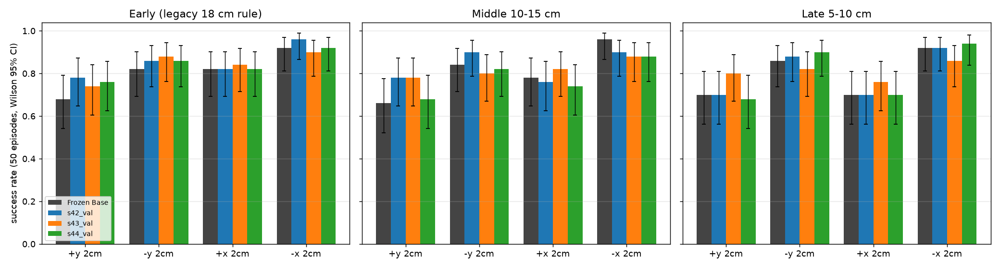
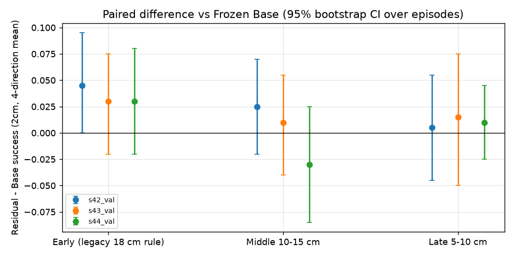
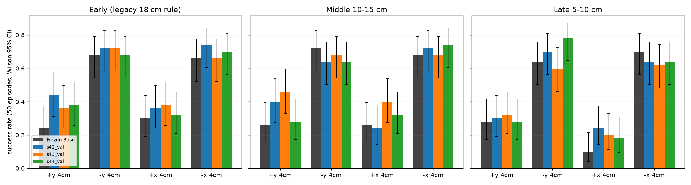

# Residual-SAC의 Dynamic LIBERO v2 교란 시점 일반화 평가 (Early / Middle / Late)

- 작성: 2026-11-24, 서버 `summit2`, 브랜치 `eval/residual-v2-generalization`
  - `eval/residual-robustness` `48d047a`에 `env/dynamic-libero-v2` `933815f`(PR #1)를 merge한 브랜치
- 목적: 기존 Residual-SAC checkpoint를 **다시 학습하지 않고**, 학습하지 않은 교란 시점(Middle, Late)과 크기(4cm)에서 Frozen Base와 비교한다. 이후 DSRL-SAC와 같은 환경, 같은 프로토콜로 직접 비교하기 위한 기준값이다.
- 원본 결과: `results/residual_v2_generalization/` (서버, git 미추적). 요약 사본: [`docs/evidence/residual_v2_generalization/`](evidence/residual_v2_generalization/)
- 표기: **측정**은 평가 기록에서 직접 계산한 값, **추정**은 그 해석이다.

## 0. 결론 요약

1. **Early(학습 조건)에서 보였던 작은 이득이 Middle/Late로 일반화되지 않는다 (측정).**
   - 2cm 4방향 평균에서 Residual − Base:

     | 시점 | 차이 | seed 범위 | 양(+)의 seed 수 |
     |---|---|---|---|
     | Early | +3.5%p | +3.0 ~ +4.5 | 3/3 |
     | Middle | +0.2%p | −3.0 ~ +2.5 | 2/3 |
     | Late | +1.0%p | +0.5 ~ +1.5 | 3/3 |

   - Middle/Late 6개 검정(3 seed × 2 시점) 모두 Holm 보정 p = 1.0이다.
   - Residual 자신의 성공률은 Early에서 Middle/Late로 가면서 2.0~6.0%p 떨어졌다. Base는 0~1.5%p만 떨어졌다.
2. **이득은 Base가 약한 +y 방향에 몰려 있고, 반대로 Middle −x는 세 seed 모두 손실이다 (측정, 탐색적).**
   - 이득: +y Middle에서 s42 +12%p(6득/0실, 보정 전 p = 0.031), s43 +12%p. +y Late에서 s43 +10%p.
   - 손실: −x Middle에서 −6~−8%p(0득/3~4실).
3. **반응적 사후 보정의 근거는 없다 (측정).**
   - +y 2cm에서 교란 직후부터 residual을 끈 ablation: 정상 대비 −2~+8%p, 모든 경우 p ≥ 0.29.
   - 같은 교란 직전 상태에서 방향만 다른 네 분기를 비교하면, residual의 방향 특이 성분은 공통 성분의 6~16%다.
   - 이전 보고서 판정(경우 1: 방향 무관 고정 보정)과 같다. **이 결과를 Reactive Adaptation이라고 부르지 않는다.**
4. **4cm(학습하지 않은 크기)에서도 같은 양상이다 (측정).**
   - Middle/Late에서 교란 적용률 100%, 거부·미발생 0건이다.
   - 4방향 평균 Residual − Base:

     | 시점 | 평균 | seed 범위 |
     |---|---|---|
     | Early | +6.8%p | +5.0 ~ +9.5 |
     | Middle | +3.7%p | +1.5 ~ +7.5 |
     | Late | +2.8%p | +0.5 ~ +4.0 |

   - Middle/Late는 Holm 보정 후 유의한 것이 없다(최소 Holm p = 0.26).
   - 이득이 보인 Middle +y 4cm와 Late +x 4cm에서도 교란 후 residual OFF가 유의한 손실을 만들지 않았다. Late +x에서는 OFF 쪽이 오히려 2~4%p 높았다.
5. **교란 적용 상태:** 모든 run에서 적용률 100%다(거부·미발생 0). 정책 간 trigger step 차이는 평균 1 step 이내다. 따라서 성공률 차이를 교란 시점 차이로 설명할 수 없다.

## 1. 설정

| 항목 | 값 |
|---|---|
| 정책 | Frozen SmolVLA (`lerobot/smolvla_libero`, `n_action_steps=10`) + Residual-SAC 6D, residual scale 0.1, 결정론적 `tanh(mu)` |
| Checkpoint (validation 선정, 변경 없음) | s42 `ckpt_00012000.pt` sha256 `a2d1bcd2…eb85` / s43 `ckpt_00007000.pt` `003a21f6…c966` / s44 `ckpt_00006000.pt` `5183fbd1…8f5c` (전체 해시: `checkpoint_sha256.txt`) |
| 비교 기준 | Frozen Base (residual 0, 같은 코드 경로) |
| 환경 | Dynamic LIBERO v2 (`make_dynamic_libero(cfg)`), LIBERO-Object task 0, 원본 init state, 280 control step |
| 조건 | `timing_middle`(10~15cm), `timing_late`(5~10cm) × ±x/±y × 2cm, 그리고 4cm(§5) |
| Episode | 조건마다 50, eval seed 0 (에피소드 i = reset·noise seed i = init state i, 모든 정책에서 같음) |
| Early | 기존 공식 평가(v1 legacy 18cm 규칙, `results/residual_robustness/evals`)를 재사용한다. v2 `primary`(legacy 구간)로 다시 실행하면 결과가 같음을 smoke test로 확인했다(§2). 명시적 `early` 구간(15~18cm)과는 다른 설정이다. |
| 학습 | 하지 않음. `rl/`과 학습 코드는 변경하지 않았다. |

**어댑터 (최소 변경)**
- `scripts/eval_residual.py`에 `--v2-set`/`--v2-condition` 옵션을 추가했다.
  - 이 옵션을 주면 시뮬레이터만 `make_dynamic_libero(cfg)`로 만들고, 나머지(VLA, `ResidualEnv`, actor, 에피소드 루프)는 그대로 쓴다.
  - v2 config와 명령줄 인자의 horizon, chunk 길이, eval seed가 다르면 실행을 거부한다.
  - 에피소드마다 `info["dynamic_libero"]`를 기록한다.
- 4cm Middle/Late는 YAML에 없는 조합이다. 같은 timing 세트에 condition token(`+y4` 등)을 넣어 만들었고, split은 `eval_secondary`로 기록된다. v2 YAML은 수정하지 않았다.
- 실행 스크립트: `scripts/run_v2_generalization.sh` (jobs 파일 형식)

## 2. 평가 전 검증 (5 Episode Smoke Test, 측정)

| 항목 | 결과 |
|---|---|
| Residual 차원 | checkpoint `action_spec.dim = 6`. 저장된 u의 1~6축은 모든 step에서 0이 아니고, 7번째(그리퍼)는 항상 0이다. |
| 실행 scale | 0.1 |
| SmolVLA chunk | `n_action_steps = 10` |
| v2 교란 | Middle 5/5, Late 5/5 적용. EEF 거리: Middle 0.142~0.150m, Late 0.092~0.100m |
| `info["dynamic_libero"]` | 모든 에피소드에서 `config`, `split`, `status`, `choice`, `episode_seed` 키가 있었다. |
| **Early(legacy) 재현** | v2 `primary/+y2`로 Base와 s42/s43/s44를 다시 실행했다. 기존 v1 결과와 5/5 에피소드에서 성공 여부, 길이, init state, 교란 이벤트가 같았다. **step별 실행 action과 residual의 최대 차이는 0이다**(정책별 868~1,051 step 비교). |

- 최초 smoke 실행은 다른 사용자의 vLLM이 GPU 메모리를 점유해 OOM으로 실패했다. 그 로그는 `failed_oom_smoke/`에 보존했고, GPU가 비었을 때 다시 실행했다.

## 3. Middle/Late 2cm 결과 (50 Episode 전체 기준)



### 3.1 방향별 성공률 (측정)

- 모든 행의 교란 적용률은 100%이고, 거부와 미발생은 0건이다.
- Wilson 95% CI는 `G_condition_summary.csv`에 있다.

| 시점 | 정책 | +y 2cm | −y 2cm | +x 2cm | −x 2cm | 4방향 평균 |
|---|---|---|---|---|---|---|
| Early | Base | 68 | 82 | 82 | 92 | 81.0 |
| Early | s42 | 78 | 86 | 82 | 96 | 85.5 |
| Early | s43 | 74 | 88 | 84 | 90 | 84.0 |
| Early | s44 | 76 | 86 | 82 | 92 | 84.0 |
| Middle | Base | 66 | 84 | 78 | 96 | 81.0 |
| Middle | s42 | 78 | 90 | 76 | 90 | 83.5 |
| Middle | s43 | 78 | 80 | 82 | 88 | 82.0 |
| Middle | s44 | 68 | 82 | 74 | 88 | 78.0 |
| Late | Base | 70 | 86 | 70 | 92 | 79.5 |
| Late | s42 | 70 | 88 | 70 | 92 | 80.0 |
| Late | s43 | 80 | 82 | 76 | 86 | 81.0 |
| Late | s44 | 68 | 90 | 70 | 94 | 80.5 |

### 3.2 Paired 차이: Residual − Base (`G_paired_vs_base.csv`)



| 시점 | Seed | 차이 (4방향) | 95% bootstrap CI | 이득/손실 에피소드 | sign-flip p | Holm p (Middle/Late 6개) |
|---|---|---|---|---|---|---|
| Early | 42 | +4.5 | [0.0, +9.5] | 18/9 | 0.11 | — (이전 보고서) |
| Early | 43 | +3.0 | [−2.0, +7.5] | 15/9 | 0.31 | — |
| Early | 44 | +3.0 | [−2.0, +8.0] | 15/9 | 0.34 | — |
| Middle | 42 | +2.5 | [−2.0, +7.0] | 14/9 | 0.38 | 1.0 |
| Middle | 43 | +1.0 | [−4.0, +5.5] | 13/11 | 0.84 | 1.0 |
| Middle | 44 | −3.0 | [−8.5, +2.5] | 13/19 | 0.39 | 1.0 |
| Late | 42 | +0.5 | [−4.5, +5.5] | 16/15 | 1.0 | 1.0 |
| Late | 43 | +1.5 | [−5.0, +7.5] | 17/14 | 0.76 | 1.0 |
| Late | 44 | +1.0 | [−2.5, +4.5] | 9/7 | 0.79 | 1.0 |

- Bootstrap은 에피소드 인덱스를 복원 추출하며, 네 방향을 함께 묶어서 뽑는다(10,000회).
- 이 장의 주 결론은 Middle/Late 4방향 평균 6개 검정(Holm 보정)에 둔다.
- 방향별 McNemar(보정 없음, 탐색적):

  | 조건 | Seed | 차이 | 이득/손실 | p |
  |---|---|---|---|---|
  | +y Middle | s42 | +12%p | 6/0 | 0.031 |
  | +y Middle | s43 | +12%p | 7/1 | 0.070 |
  | +y Late | s43 | +10%p | 5/0 | 0.063 |
  | −x Middle | s42 / s43 / s44 | −6 / −8 / −8%p | 0/3, 0/4, 0/4 | ≥ 0.125 |

  - 탐색적 비교는 정책 세트당 24개이므로, 보정 전 p 0.031 하나는 우연으로도 충분히 나올 수 있다.

### 3.3 Seed 간 일관성 (`G_seed_consistency.csv`, n = 3)

| 시점 | 차이 평균 ± SD | 범위 | 양(+)의 seed |
|---|---|---|---|
| Early | +3.5 ± 0.9 | +3.0 ~ +4.5 | 3/3 |
| Middle | +0.2 ± 2.8 | −3.0 ~ +2.5 | 2/3 |
| Late | +1.0 ± 0.5 | +0.5 ~ +1.5 | 3/3 |

- **측정:** Early에서는 세 seed의 방향과 크기가 일관됐지만, Middle에서는 부호도 엇갈린다.
- 방향별로 보면 +y 이득은 s42와 s43에서 크고(+10~+12%p) s44에서는 작다(−2~+2%p). −x Middle 손실은 세 seed 모두에서 나타났다.

### 3.4 Early 대비 변화 (같은 정책, 같은 에피소드끼리 paired, `G_timing_change_vs_early.csv`)

| 정책 | Middle − Early | 95% CI | Late − Early | 95% CI |
|---|---|---|---|---|
| Base | 0.0 | [−1.5, +1.5] | −1.5 | [−5.5, +3.0] |
| s42 | −2.0 | [−5.0, +1.0] | **−5.5** | [−10.5, −0.5] |
| s43 | −2.0 | [−6.0, +2.0] | −3.0 | [−9.0, +3.0] |
| s44 | **−6.0** | [−10.0, −2.5] | −3.5 | [−9.0, +1.5] |

- **측정:** Base는 교란 시점에 거의 둔감하다. Residual은 Middle/Late에서 성공률이 떨어지고, 그 결과 Base 대비 이득이 사라진다.
  - Base가 둔감한 이유는 교란 후에도 VLA가 재계획할 시간이 충분하기 때문으로 보인다(추정, 이전 보고서 §5.2).
- **추정:** Residual의 고정 보정은 18cm 시점에 맞춰 학습된 궤적에서 효과가 있었다. 교란 시점이 바뀌면 그 보정이 맞지 않거나 해가 될 수 있다.
  - 예를 들어 Late +x에서 s42는 Early 82% → Late 70%로 떨어졌다.

### 3.5 교란 적용, trigger step, EEF 거리, 성공 에피소드 길이 (측정)

| 시점 | 정책 | 적용 / 거부 / 미발생 (4방향 합) | trigger step 평균 (범위) | EEF 거리 범위 (m) | 성공 에피소드 길이 중앙값 (+y / −y / +x / −x) |
|---|---|---|---|---|---|
| Middle | Base | 200 / 0 / 0 | 37.1 (32~42) | 0.140~0.150 | 142 / 149 / 138 / 139 |
| Middle | s42 | 200 / 0 / 0 | 37.1 (32~42) | 0.139~0.150 | 141 / 169 / 139 / 138 |
| Middle | s43 | 200 / 0 / 0 | 36.6 (31~41) | 0.140~0.150 | 140 / 173 / 139 / 139 |
| Middle | s44 | 200 / 0 / 0 | 37.0 (31~42) | 0.140~0.150 | 141.5 / 170 / 139 / 139 |
| Late | Base | 200 / 0 / 0 | 42.0 (37~46) | 0.089~0.100 | 142 / 169 / 138 / 139 |
| Late | s42 | 200 / 0 / 0 | 42.0 (37~46) | 0.090~0.100 | 140 / 169 / 139 / 139 |
| Late | s43 | 200 / 0 / 0 | 41.7 (36~46) | 0.090~0.100 | 140.5 / 177 / 139 / 139 |
| Late | s44 | 200 / 0 / 0 | 41.8 (37~46) | 0.089~0.100 | 144 / 170 / 138 / 139 |

- 비교 기준 Early(legacy)의 trigger step 평균은 33.1~33.5(27~39)이고, EEF 거리는 0.171~0.180m다.
- 교란 적용률이 모두 100%이므로 "적용된 에피소드만의 성공률"과 "전체 50 에피소드 성공률"이 같다. 그래도 표의 성공률은 모두 전체 50 에피소드 기준이다.
- 정책 간 trigger step 차이는 평균 1 step 이내, EEF 거리 차이는 1mm 이내다. 따라서 Residual이 접근 경로를 바꿔 교란 시점 자체를 바꾸는 효과는 무시할 수 있다(측정).
- 성공 에피소드 길이는 Base와 Residual이 거의 같다. −y 조건에서만 Residual이 0~8 step 길다.

## 4. 반응적 보정 검사

### 4.1 교란 후 Residual OFF ablation (+y 2cm, 이득이 관찰된 방향, `G_postoff_ablation.csv`)

| 시점 | Seed | 정상 | 교란 후 OFF | Base | 정상 − OFF | 정상만 성공 / OFF만 성공 | McNemar p |
|---|---|---|---|---|---|---|---|
| Middle | 42 | 78 | 70 | 66 | +8 | 6/2 | 0.29 |
| Middle | 43 | 78 | 74 | 66 | +4 | 4/2 | 0.69 |
| Middle | 44 | 68 | 70 | 66 | −2 | 4/5 | 1.0 |
| Late | 42 | 70 | 68 | 70 | +2 | 4/3 | 1.0 |
| Late | 43 | 80 | 74 | 70 | +6 | 4/1 | 0.38 |
| Late | 44 | 68 | 66 | 70 | +2 | 4/3 | 1.0 |
| Early (참고, 이전 보고서) | 42 / 43 / 44 | 78 / 74 / 76 | 72 / 74 / 70 | 68 | +6 / 0 / +6 | — | ≥ 0.45 |

- **측정:** 교란 후 residual을 꺼도 유의한 손실이 없다.
- +y Middle s42/s43의 Base 대비 이득(+12%p)은 OFF 상태에서도 +4~+8%p 남는다. 즉 이득의 일부는 교란 이전의 residual에서 온다.
- 교란 후 residual의 기여는 +y Middle/Late에서 seed 5/6개가 양수(+2~+8%p)이지만, 개별적으로 유의하지 않다.
- **추정:** 교란 후 residual이 작은 기여를 할 가능성은 배제할 수 없다. 그러나 그 기여가 방향을 구분한 보정이라는 근거는 없다(§4.2).

### 4.2 같은 교란 직전 상태에서 분기한 방향별 반응 (`G_branch_response.csv`)

- 같은 정책·같은 시점에서 네 방향 run은 교란 직전까지 관측이 완전히 같았다(최대 차이 0). trigger step도 50/50 에피소드에서 같았다.
- 따라서 네 run을 같은 상태에서 방향만 다르게 갈라진 분기로 쓸 수 있다.
- 지표: 방향 특이 residual(`mean_d ||u_d − ū||`)과 공통 residual(`||ū||`)을 실행 단위(×0.1)로 계산했다.

| Seed | 시점 | k=1 특이 | k=10 특이 | k=20 특이 | 공통 (k=1~20 평균) | 비율 |
|---|---|---|---|---|---|---|
| 42 | Early / Middle / Late | 0.00000 / 0.00001 / 0.00002 | 0.0003 / 0.0003 / 0.0025 | 0.0020 / 0.0021 / 0.0022 | 0.0097 / 0.0104 / 0.0113 | 0.06 / 0.09 / 0.12 |
| 43 | Early / Middle / Late | 0.00000 / 0.00001 / 0.00002 | 0.0003 / 0.0004 / 0.0031 | 0.0028 / 0.0023 / 0.0019 | 0.0096 / 0.0094 / 0.0089 | 0.08 / 0.12 / 0.16 |
| 44 | Early / Middle / Late | 0.00002 / 0.00002 / 0.00002 | 0.0004 / 0.0004 / 0.0018 | 0.0016 / 0.0022 / 0.0023 | 0.0085 / 0.0086 / 0.0087 | 0.06 / 0.10 / 0.15 |

- **측정:**
  - 교란 직후(k=1)에는 방향 특이 residual이 사실상 0이다(≤ 2e-5).
  - Late에서는 k=10 근처에서 방향 특이 성분이 커진다. VLA가 재계획해 base action이 방향에 따라 달라진 다음이다.
  - 그래도 공통 성분의 12~16% 수준이다.
- **추정:** Residual은 VLA의 base action 변화를 통해서만 교란을 간접적으로 감지한다. 관측에 물체 위치가 없기 때문이다.

### 4.3 판정

- Middle/Late 2cm에서 Base 대비 유의한 이득이 없다.
- +y 방향의 이득은 교란 후 residual을 꺼도 대부분 남는다.
- 방향 특이 반응은 작다.
- → 이전 보고서의 **경우 1(방향 무관 고정 보정)과 같다. Reactive Adaptation이라는 근거는 없다.**

## 5. 4cm 일반화 평가 (학습하지 않은 조건, 별도 보고)

### 5.1 물리적 적용 가능성 (측정, Frozen Base 먼저)

- Base를 Middle/Late × ±x/±y × 4cm(8 run × 50 ep)로 먼저 돌렸다. **400/400 에피소드에서 교란이 적용됐고, 충돌 거부와 미발생은 0건이다.**
- 이어서 Residual 3 seed(24 run)를 평가했다. 이쪽도 1,200/1,200 에피소드에서 적용됐다.
- 4cm는 학습에 쓰지 않은 조건이고, 2cm와 섞지 않고 따로 보고한다.
- Early 4cm는 기존 공식 평가(legacy)를 재사용했다.



### 5.2 방향별 성공률 (측정, 50 ep 전체 기준, 적용률 모두 100%)

| 시점 | 정책 | +y 4cm | −y 4cm | +x 4cm | −x 4cm | 4방향 평균 |
|---|---|---|---|---|---|---|
| Early | Base | 24 | 68 | 30 | 66 | 47.0 |
| Early | s42 / s43 / s44 | 44 / 36 / 38 | 72 / 72 / 68 | 36 / 38 / 32 | 74 / 66 / 70 | 56.5 / 53.0 / 52.0 |
| Middle | Base | 26 | 72 | 26 | 68 | 48.0 |
| Middle | s42 / s43 / s44 | 40 / 46 / 28 | 64 / 68 / 64 | 24 / 40 / 32 | 72 / 68 / 74 | 50.0 / 55.5 / 49.5 |
| Late | Base | 28 | 64 | 10 | 70 | 43.0 |
| Late | s42 / s43 / s44 | 30 / 32 / 28 | 70 / 60 / 78 | 24 / 20 / 18 | 64 / 62 / 64 | 47.0 / 43.5 / 47.0 |

### 5.3 Paired 차이: Residual − Base (4방향, `4cm/G_paired_vs_base.csv`)

| 시점 | s42 | s43 | s44 | 평균 (n=3) |
|---|---|---|---|---|
| Early | +9.5 [+4.0, +15.0], p = 0.002 | +6.0 [−1.0, +13.5], p = 0.14 | +5.0 [−1.5, +12.0], p = 0.21 | +6.8 |
| Middle | +2.0 [−3.5, +8.0], p = 0.62 | **+7.5 [+1.0, +14.0], p = 0.044** | +1.5 [−4.5, +7.0], p = 0.74 | +3.7 |
| Late | +4.0 [−3.0, +11.0], p = 0.34 | +0.5 [−5.5, +7.0], p = 1.0 | +4.0 [−3.0, +10.5], p = 0.33 | +2.8 |

- 대괄호는 95% paired bootstrap CI, p는 sign-flip permutation(200,000회)이다.
- Middle/Late 6개 검정에 Holm 보정을 하면 가장 작은 값이 s43 Middle의 0.26이다. **유의한 결과가 없다.**
- Early 4cm의 s42 결과(p = 0.002)는 이전 보고서의 주 검정이다. 독립성 주의가 붙는다.
- **측정:** 세 seed, 세 시점 모두 차이가 양수(+0.5~+9.5%p)이고, Early에서 Middle/Late로 갈수록 작아진다.
- 방향별(탐색적, 보정 없음):

  | 조건 | Seed | 차이 | 이득/손실 | p |
  |---|---|---|---|---|
  | Middle +y | s43 | +20%p | 11/1 | 0.006 |
  | Middle +y | s42 | +14%p | 8/1 | 0.039 |
  | Late +x | s42 | +14%p | 8/1 | 0.039 |
  | Middle −y | 세 seed | −4~−8%p | — | 모두 ≥ 0.34 |

- Early 대비 변화 (같은 정책, paired):

  | 정책 | Middle − Early | Late − Early |
  |---|---|---|
  | Base | +1.0 | −4.0 |
  | s42 | −6.5 | −9.5 |
  | s43 | +2.5 | −9.5 |
  | s44 | −2.5 | −5.0 |

  - **측정:** Late에서는 Residual이 Base보다 더 많이 떨어진다.

### 5.4 Trigger step, EEF 거리, 성공 에피소드 길이 (측정)

- Trigger step 평균: Middle 36.6~37.1, Late 41.7~42.0, Early 33.1~33.5. 정책 간 차이는 0.5 step 이내다.
- EEF 거리: Middle 0.140~0.150m, Late 0.089~0.100m.
- 성공 에피소드 길이 중앙값은 Base와 Residual이 대부분 비슷하다(−y 4cm는 약 200~215 step으로 길다).
- 예외적으로 **Late +x 4cm에서 Residual의 성공 에피소드가 Base보다 길다**: 154~179 vs 140 step.
  - Base는 이 조건에서 5/50만 성공한다. Residual의 추가 성공은 느리게라도 회복한 에피소드다(측정).
- ±y 4cm는 280 step 제한에 의해 결과가 잘리는 조건이다(이전 보고서 §5.3). 이번 결과도 280 step 공식 기준이다.

### 5.5 교란 후 Residual OFF ablation (이득이 관찰된 Middle +y 4cm, Late +x 4cm)

| 조건 | Seed | 정상 | 교란 후 OFF | Base | 정상 − OFF [95% CI] | 정상만 성공 / OFF만 성공 | McNemar p |
|---|---|---|---|---|---|---|---|
| Middle +y 4cm | 42 | 40 | 30 | 26 | +10 [−2, +22] | 7/2 | 0.18 |
| Middle +y 4cm | 43 | 46 | 38 | 26 | +8 [−2, +20] | 6/2 | 0.29 |
| Middle +y 4cm | 44 | 28 | 26 | 26 | +2 [−8, +12] | 4/3 | 1.0 |
| Late +x 4cm | 42 | 24 | 28 | 10 | −4 [−16, +8] | 4/6 | 0.75 |
| Late +x 4cm | 43 | 20 | 22 | 10 | −2 [−14, +10] | 5/6 | 1.0 |
| Late +x 4cm | 44 | 18 | 22 | 10 | −4 [−14, +6] | 2/4 | 0.69 |

- **측정 (Late +x 4cm):** 교란 후 residual을 꺼도 성공률이 같거나 오히려 높다(22~28% vs Base 10%). 이 조건의 이득은 **전부 교란 이전 구간의 residual**에서 나온다.
- **측정 (Middle +y 4cm):** OFF로 하면 2~10%p 낮아지지만 유의하지 않다.
  - 그리고 Base 대비 이득 중 OFF 상태에서도 남는 몫이 s42 +4%p, s43 +12%p다.
- 분기 분석(`4cm/G_branch_response.csv`): 방향 특이 / 공통 residual 비율은 0.08~0.21이다(Early 0.08~0.10, Middle 0.11~0.14, Late 0.16~0.21). 교란 직전 관측 차이는 0이다.
  - 교란 시점이 늦을수록 비율이 커진다. 재계획 후 VLA의 base action 변화를 residual이 따라가기 때문이다(추정).
  - 그래도 공통 성분이 대부분이다.
- **판정:** 4cm에서도 **경우 1(방향 무관 고정 보정)**에 해당한다.
  - Middle +y 4cm에서 교란 후 residual이 일부 기여할 가능성은 seed 2개에서 수치상 보이지만, 통계적으로 확인되지 않았다.
  - **Reactive Adaptation이라고 부르지 않는다.**

## 6. DSRL-SAC 비교를 위한 기준값

- DSRL-SAC도 이 표를 같은 조건에서 재현하면 된다. 같은 checkpoint 선택 규칙과 같은 v2 세트를 쓰고, 에피소드 단위 paired 비교를 한다.
  - 공식 지표: `primary` (Early / legacy 2cm, 280 step)
  - 보조 지표: `timing_middle`, `timing_late` 2cm와 4cm
- 기준값 (4방향 평균 성공률 %, 50 ep × 4방향). 4cm는 Early 47.0 / Middle 48.0 / Late 43.0(Base)이고, Residual은 §5.2에 있다.
- 2cm:

  | 시점 | Frozen Base | Residual s42 / s43 / s44 | Residual 평균 |
  |---|---|---|---|
  | Early (legacy) | 81.0 | 85.5 / 84.0 / 84.0 | 84.5 |
  | Middle | 81.0 | 83.5 / 82.0 / 78.0 | 81.2 |
  | Late | 79.5 | 80.0 / 81.0 / 80.5 | 80.5 |

- 에피소드 단위 결과는 `docs/evidence/residual_v2_generalization/episodes/`에 있다. 같은 init state로 DSRL 결과와 짝지어 비교할 수 있다.
- 권장 사항:
  - DSRL에도 교란 후 개입 OFF ablation과 §4.2 분기 분석을 같은 방식으로 적용한다.
  - "적응"이라는 표현은 방향 특이 반응과 ablation 기여가 모두 확인될 때만 쓴다.

## 7. 한계

- Checkpoint는 seed당 하나(validation 선정)다. seed 42 checkpoint는 이전 보고서에서 밝힌 것처럼 완전히 독립적인 test로 선택된 것이 아니다.
- Task 하나(목표 물체 위치 고정)이고, 원본 init state 50개다.
- 50 에피소드 paired 설계로 4방향 평균의 95% CI 반폭은 약 ±5%p다. 2~3%p 수준의 차이는 구분할 수 없다.
- 방향별 비교와 ablation은 탐색적이고 다중 비교 보정을 하지 않았다.
- Middle/Late의 trigger 시점은 Frozen Base 궤적 기준으로 확인한 범위다(적용률 100%). 이 평가의 정책들 사이에서는 차이가 무시할 수준이었다.

## 8. 파일 및 재현

| 파일 | 내용 |
|---|---|
| `scripts/eval_residual.py` | v2 어댑터 추가(`--v2-set`, `--v2-condition`). 나머지 평가 경로는 변경 없음. |
| `scripts/run_v2_generalization.sh` | jobs 파일 기반 병렬 실행. 기존 결과는 건너뛴다. |
| `scripts/check_v2_eval_smoke.py` | Smoke 검사(6D, chunk, v2 키, legacy step 단위 재현) |
| `scripts/analyze_v2_generalization.py` | 조건 요약, paired 비교, Holm, 시점 변화, seed 일관성, ablation, 분기 반응, 그림 |
| `docs/evidence/residual_v2_generalization/` | `2cm/`, `4cm/` 분석 CSV·JSON·그림, smoke 결과, jobs 파일, checkpoint 해시, 에피소드 단위 결과(`episodes/`) |

```bash
cd ~/rf/steer-frozen-vla && git checkout eval/residual-v2-generalization
source scripts/server_env.sh 0
R=<run root>/results   # 학습 결과가 있는 위치 (checkpoint 해시: docs/evidence/residual_v2_generalization/checkpoint_sha256.txt)
# 단일 평가 예: s43, Middle +y 2cm
"$PY" scripts/eval_residual.py --checkpoint $R/residual_6d_rand_fixa001_2cm_s43_20k/checkpoints/ckpt_00007000.pt \
    --v2-set timing_middle --v2-condition=+y2 --episodes 50 --seed 0 --save-steps --out results/x/s43_val_middle_py2.json
# 전체: jobs 파일 (docs/evidence/residual_v2_generalization/jobs_*.txt)
OUT=results/residual_v2_generalization/evals JOBS=12 scripts/run_v2_generalization.sh <jobs_file>
"$PY" scripts/check_v2_eval_smoke.py results/residual_v2_generalization/smoke --v1-dir results/residual_robustness/evals
"$PY" scripts/analyze_v2_generalization.py --distance 2 --v1-dir results/residual_robustness/evals
"$PY" scripts/analyze_v2_generalization.py --distance 4 --v1-dir results/residual_robustness/evals
```

- 실행 환경: GPU 0~3에서 동시에 최대 12~14개 작업을 돌렸다. 다른 사용자의 vLLM과 GPU를 공유했다.
- 실행 규모: 평가 run 76개 × 50 ep(2cm Middle/Late 32, 4cm Base 8 + Residual 24, ablation 12)와 smoke 8개 × 5 ep다.
